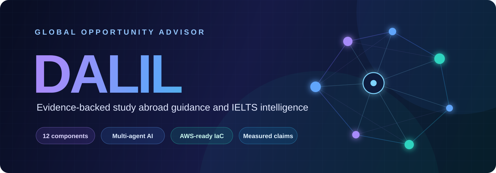
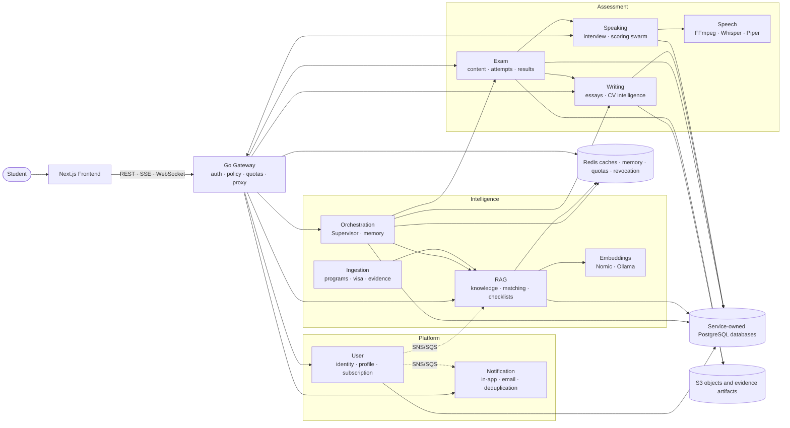
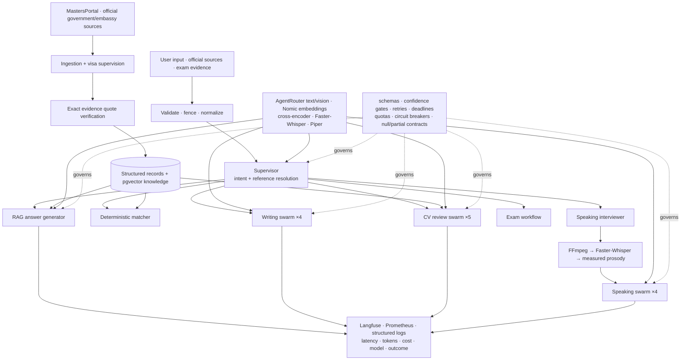
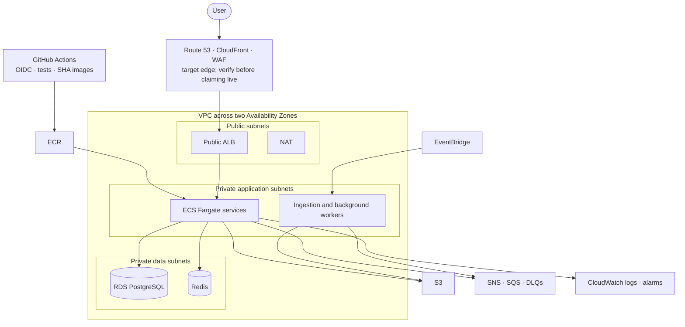

<div align="center">



<br />

[](https://github.com/ITI-OpenSource-Alex/GOA/actions/workflows/ci.yml)
[](https://github.com/ITI-OpenSource-Alex/GOA/actions/workflows/evals.yml)
[](docker-compose.yml)
[](services)
[](services)
[](services)

### One connected platform for study-abroad discovery, application readiness, and IELTS improvement

[Quick start](#-quick-start) · [Architecture](#-architecture) · [AI agents](#-ai-agent-topology) · [Services](#-service-catalog) · [Evaluation](#-evidence-not-vibes) · [Documentation](#-documentation-map)

</div>

---

## ✦ What is Dalil?

Dalil—internally developed as **GOA, the Global Opportunity Advisor**—helps students move from “I want to study abroad” to a traceable application plan.

It combines a personalized opportunity catalogue, official-source visa guidance, grounded conversational assistance, application checklists, CV review, and all four IELTS skill workflows. The platform is built as a polyglot, event-aware system whose most important rule is simple:

> **A model may interpret evidence. It may never become the evidence.**

<table>
<tr>
<td width="33%" valign="top">

### 🎓 Discover

- Program catalogue and filters
- Deterministic eligibility gates
- Explainable ranking
- Visa and financial evidence
- Persistent application checklists

</td>
<td width="33%" valign="top">

### 🧠 Prepare

- Grounded Dalil assistant
- Profile-aware recommendations
- CV extraction and five-part review
- Four-agent Writing evaluation
- Progress-aware Exam guidance

</td>
<td width="33%" valign="top">

### 🎙️ Practise

- Reading and Listening exams
- Academic and General Writing
- Three-part Speaking interviews
- Local speech-to-text and TTS
- Criterion-level, evidence-linked feedback

</td>
</tr>
</table>

## ◈ Architecture

The browser talks to one public trust boundary. Behind it, each service owns a cohesive domain, its own persistence contract, and its own failure semantics.



### Architectural invariants

| Invariant | Consequence |
|---|---|
| **One authoritative owner per persistent fact** | No cross-service SQL and no cross-service foreign keys |
| **The Gateway is the public backend boundary** | Browser auth, subscription policy, ownership, quotas, and protocol proxying stay centralized |
| **Transport follows interaction semantics** | REST for immediate authority, SSE for generated streams, WebSocket for live audio, SNS/SQS for asynchronous propagation |
| **Missing is a real state** | Missing ≠ zero, refusal ≠ outage, partial ≠ complete, fallback ≠ original model |
| **External content is untrusted** | Scraped pages, chat, essays, CV text, and retrieved chunks are fenced and validated |
| **Claims require artifacts** | Tests, datasets, fingerprints, traces, reports, and dated measurements outrank intentions |

Explore the detailed [software architecture](docs/architecture.md), [AI architecture](docs/AI_ARCHITECTURE.md), [AWS architecture](docs/AWS_ARCHITECTURE.md), and [event catalog](docs/event-catalog.md).

## ⬡ AI agent topology

Dalil uses specialized agents where independent rubrics or decisions improve explainability. Deterministic code remains responsible for authority, routing policy, schemas, aggregation, and abstention.



<details>
<summary><strong>See every major agent role</strong></summary>

| Family | Roles | What code still controls |
|---|---|---|
| Conversation | Supervisor router, long-term fact extractor | Paid-feature policy, Exam authority, memory sanitization, fallback routing |
| Evidence | Visa Supervisor, visa fact extractor, RAG answer generator | Official-domain allowlist, quote verification, confidence refusal, citations |
| Writing | Task Response/Achievement, Coherence and Cohesion, Lexical Resource, Grammar | Concurrent execution, schema parsing, retries, exact offsets, half-band aggregation |
| CV | Structure, Skills Gaps, ATS Keywords, Length, Country Conventions | File validation, extraction state, fenced context, deterministic mean, versioned cache |
| Speaking | Interviewer, Fluency and Coherence, Lexical Resource, Grammar, Pronunciation | Three-part state machine, measured prosody, timeouts, minimum-three overall-band rule |
| Multimodal | Academic Task 1 chart description, STT, TTS | S3 ownership, MIME validation, FFmpeg decoding, evidence-limited claims |

</details>

## ▦ Service catalog

| Component | Stack | Owns | Local port |
|---|---|---|---:|
| `frontend` | Next.js · React · TypeScript | Product UI, streams, exam state, audio capture | `3000` |
| `gateway` | Go | Public routing, auth enforcement, quotas, ownership, REST/SSE/WS proxy | `8080` |
| `user` | NestJS · TypeScript | Identity, profile, refresh tokens, subscriptions, account lifecycle | `8081` |
| `speaking` | Go | Interview state, follow-ups, rubric agents, Speaking history | `8082` |
| `orchestration` | FastAPI · Python | Supervisor routing, conversation memory, downstream coordination | `8083` |
| `rag` | FastAPI · Python · pgvector | Documents, FAQs, programs, visa evidence, matching, checklists | `8084` |
| `exam` | FastAPI · Python | Question bank, timers, attempts, deterministic grading, history | `8085` |
| `speech` | FastAPI · Python | Audio decoding, Faster-Whisper STT, Piper TTS, timing/confidence | `8086` |
| `notification` | TypeScript · Node.js | Notification records, templates, email delivery, deduplication | `8087` |
| `writing` | FastAPI · Python | Essay evaluation, CV uploads, extracted CVs, review results | `8000` |
| `ingestion` | Python worker | Crawl state, source adapters, evidence extraction, completion reports | worker |
| `embeddings` | Ollama-facing component | Local `nomic-embed-text` embedding boundary | host Ollama |

Shared contracts, pricing, and security helpers live under [`packages/`](packages/).

## ☁ AWS target architecture

The repository contains Terraform and deployment workflows for the AWS design. Treat infrastructure represented in code and infrastructure verified live as separate claims.



See [`infra/terraform`](infra/terraform), the [AWS architecture](docs/AWS_ARCHITECTURE.md), and the deployment workflows under [`.github/workflows`](.github/workflows).

## ⚡ Quick start

### Prerequisites

- Docker Desktop or Docker Engine with Compose v2
- Git
- Ollama running on the host
- A configured AgentRouter/Anthropic-compatible key for live AI paths

### 1. Clone and configure

```bash
git clone https://github.com/ITI-OpenSource-Alex/GOA.git
cd GOA
cp .env.example .env
```

PowerShell equivalent:

```powershell
Copy-Item .env.example .env
```

Add provider credentials to `.env`. Never commit that file. The project-scoped provider setting is `GOA_LLM_BASE_URL`; see [AgentRouter setup](AGENTROUTER-SETUP.md) and the [inference runbook](docs/INFERENCE.md).

### 2. Prepare local embeddings

```bash
ollama pull nomic-embed-text
ollama list
```

The RAG database expects **768-dimensional** embeddings. Replacing the model with a different-width embedding model will fail at insert/query time.

### 3. Start the full stack

```bash
docker compose up -d --build
docker compose ps
```

The Compose stack includes the frontend, application services, PostgreSQL/pgvector, two Redis roles, LocalStack, Prometheus, Pushgateway, and Grafana.

### 4. Open the platform

| Surface | URL |
|---|---|
| Dalil frontend | <http://localhost:3000> |
| Gateway health | <http://localhost:8080/health> |
| Grafana | <http://localhost:3001> — `admin / admin` |
| Prometheus targets | <http://localhost:9090/targets> |
| LocalStack health | <http://localhost:4566/_localstack/health> |

```bash
curl http://localhost:8080/health
curl http://localhost:4566/_localstack/health
```

### 5. Stop or inspect

```bash
make logs
make down
```

For detailed setup and question-bank ingestion, read [`docs/local-dev-setup.md`](docs/local-dev-setup.md).

## ✓ Testing and quality gates

The repository uses change-aware CI across Go, Python, and TypeScript services, plus dedicated Writing, Speaking, and evaluation workflows.

```bash
# Gateway
cd services/gateway && go test ./...

# Speaking
cd services/speaking && go test ./...

# Orchestration
docker compose exec orchestration pytest

# RAG
docker compose exec rag pytest

# Writing
docker compose exec writing pytest

# User
cd services/user && npm ci && npm run lint && npm run test:cov

# Frontend journeys
cd services/frontend && npm ci && npm run test:e2e

# Cross-service evaluation harness
python -m pytest evals/tests
```

> [!CAUTION]
> Live LLM, scraping, email, and speech runs can consume quota, call external systems, or saturate local CPU. Use the repository's flags, cassettes, frozen corpora, and explicit live-test commands rather than running them accidentally.

## ◉ Evidence, not vibes

Every benchmark should identify its hypothesis, dataset, configuration fingerprint, metric, result, uncertainty, and resulting engineering decision.

| Experiment | Evidence | Engineering consequence |
|---|---:|---|
| LLM client reuse | p50 `907.5 ms → 295.4 ms`; 20 test connections → 1 | Reuse process-wide clients |
| Frozen RAG benchmark | Hybrid Recall@10 `0.8000 → 0.7667` in the cited comparison | Keep hybrid behind a flag; dense remains default |
| Writing validation | `n=3`, accuracy `33.3–66.7%` across recorded runs | Do not claim validation; expand to 20+ examiner-labelled essays |
| Speaking transcript lane | `n=10`, MAE `0.15`, all within half a band | Strong partial evidence; no acoustic Pronunciation claim |
| Speaking real-audio lane | `n=8`, MAE `1.0`, bias `−0.875` | Investigate high-band under-scoring; remain non-gating |
| Speaking capacity | healthy at 1–2 concurrent CPU sessions; breaks under higher load | Transcription compute is the capacity wall |
| Security run | 11 defended, 0 complied, 1 inconclusive | Retain layered defense and honest inconclusive classification |

Start with [`evals/`](evals), [`perf/reports/`](perf/reports), the [RAG benchmark decision](perf/reports/GOA-137-delta.md), the [load-test report](perf/reports/GOA-036-report.md), and the [security evidence](docs/security/goa-034-evidence.md).

## ◌ Observability and cost

| Layer | Purpose |
|---|---|
| **Langfuse** | Supervisor and model spans, hierarchy, model identity, tokens, latency, parse outcome, and cost |
| **Prometheus + Grafana** | Application, transport, agent, queue, and SLO metrics in local environments |
| **CloudWatch** | AWS logs, alarms, task and infrastructure operations when a live AWS environment exists |
| **Structured logs** | Correlation IDs and privacy-safe events across service boundaries |
| **Central pricing package** | Consistent token-cost accounting without treating unknown pricing as zero |

Local inference has zero token price—not zero cost. CPU time, model residency, queueing, and concurrency are measured capacity constraints.

## ⌘ Repository map

```text
GOA/
├── services/          # 12 application components
├── packages/          # shared contracts, pricing, and security helpers
├── infra/             # Terraform, seeders, and deployment infrastructure
├── monitoring/        # Prometheus and Grafana configuration
├── evals/             # frozen corpora, graders, benchmarks, and reports
├── perf/              # load tests, fixtures, deltas, and measurements
├── tests/             # cross-service contract and integration tests
├── scripts/           # operational, demo, evidence, and maintenance tools
├── reports/           # product and frontend audit artifacts
├── docs/              # architecture, runbooks, security, design, and decisions
├── .github/workflows/ # CI, evaluation, deployment, and promotion workflows
└── docker-compose.yml # reproducible local platform
```

## ⧉ Documentation map

| Area | Start here |
|---|---|
| System boundaries | [Architecture overview](docs/architecture.md) |
| AI pipelines and agents | [AI architecture](docs/AI_ARCHITECTURE.md) |
| AWS and deployment | [AWS architecture](docs/AWS_ARCHITECTURE.md) · [Terraform](infra/terraform) |
| Inference configuration | [Inference runbook](docs/INFERENCE.md) · [AgentRouter setup](AGENTROUTER-SETUP.md) |
| Events and contracts | [Event catalog](docs/event-catalog.md) · [Shared contracts](packages/contracts) |
| Security | [Threat model](docs/security/threat-model.md) · [Security evidence](docs/security/goa-034-evidence.md) |
| Observability | [Observability guide](docs/GOA-027-OBSERVABILITY.md) · [Monitoring](monitoring) |
| Writing swarm | [Writing evaluation design](docs/GOA-014-writing-evaluation-swarm.md) |
| Local development | [Setup guide](docs/local-dev-setup.md) |
| Git workflow | [Contribution workflow](docs/git-workflow.md) |
| Evaluation | [Evaluation harness](evals) · [Performance reports](perf/reports) |

## 🔐 Security posture

- HttpOnly access and refresh cookies with rotation and server-side revocation
- Resource ownership checks beyond JWT validity
- Explicit CORS allowlist and feature-specific quotas
- Prompt-injection fencing for user, uploaded, retrieved, remembered, and scraped text
- Evidence validation for extracted visa facts
- Strict model-output schemas and bounded retries
- Presigned object access rather than public buckets
- Correlation without raw sensitive payloads in security logs

Security is layered, not declared solved. Regex detection can be evaded, model behavior is probabilistic, and an empty or truncated response is never counted automatically as a defended attack.

## ⚠ Current boundaries

This is an ambitious graduation system with unusually strong evidence discipline. It is not presented as a finished global production platform.

- Model quality varies by dataset and sample size; Writing validation remains insufficient.
- Full audio-based Speaking evaluation shows under-scoring and limited concurrency on local CPU STT.
- Provider queueing can dominate chat latency.
- Terraform proves represented infrastructure, not live deployment state.
- Academic Task 1 image delivery, the final Speaking UI path, and live environment health must be verified before demonstration claims.
- The exact Gold-tier status belongs to the current dated evidence package, not to this README badge or an architectural diagram.

## ↗ Contributing

1. Branch from `develop` using `feat/GOA-123-short-name` or `fix/GOA-123-short-name`.
2. Preserve service ownership and update every language implementation of a shared contract together.
3. Add behavior-focused tests in the owning service.
4. Run the relevant unit suite and a real cross-service flow when a boundary changes.
5. Use scoped Conventional Commits such as `fix(rag): handle embedding timeout`.
6. Open a PR to `develop`, link the ticket, list verification, and attach UI evidence when relevant.

Read the complete [Git workflow](docs/git-workflow.md) before opening a pull request.

---

<div align="center">

### Built around one engineering principle

## **Own every fact. Constrain every model. Measure every claim.**

<sub>Dalil · Global Opportunity Advisor · ITI Graduation Project</sub>

</div>
