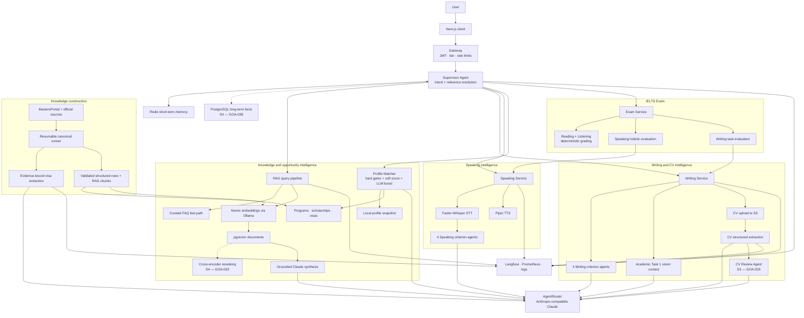
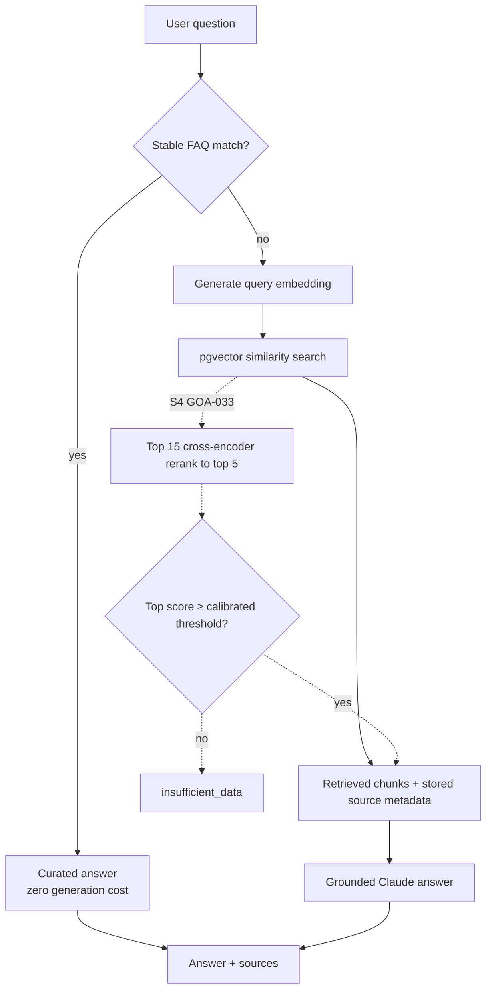
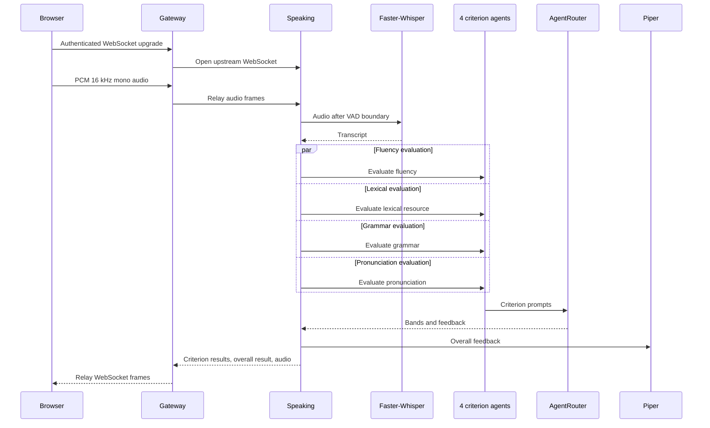
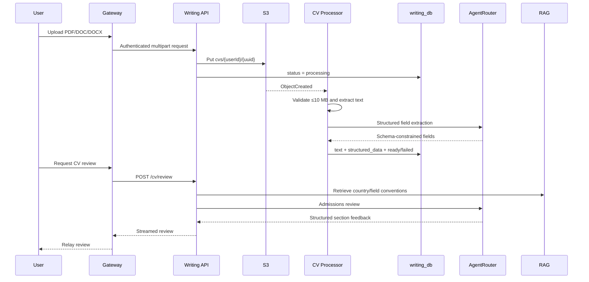

# GOA AI Architecture

**Architecture baseline:** Mid-Sprint 3

**Last reviewed:** 2026-07-27

**Normative sources:**

- `../../Docs/GOA_Sprint_1_Tickets.md`
- `../../Docs/GOA_Sprint_2_Tickets.md`
- `../../Docs/GOA_Sprint_3_Tickets.md`
- `../../Docs/GOA_Sprint_4_Tickets.md`

## 1. Authority and status convention

The sprint tickets define the intended AI architecture. Code, configuration, and evaluation artifacts are used only to check conformance.

| Label | Meaning |
| --- | --- |
| **S1–S2 baseline** | Foundation and Core AI scope expected before Sprint 3. |
| **S3 in progress** | Current Integration work. Ticket targets must not be described as achieved until their definitions of done pass. |
| **S4 planned** | Production-quality, guardrail, performance, and refinement work. |

Explicit corrections and rescope notes in later sprint tickets override older acceptance-criteria text. This matters for the model provider, speech stack, visa adapters, chart delivery, and evaluation claims.

## 2. AI evolution by sprint

| Sprint | AI outcome |
| --- | --- |
| **Sprint 1 — Foundation** | Supervisor routing, short-term memory, basic RAG, real-time speech pipeline, Writing submission, ingestion framework, Exam ownership, and first observability hooks. |
| **Sprint 2 — Core AI** | Three-stage matching, four-agent Speaking and Writing swarms, real source adapters, profile snapshots, full intent wiring, RAG/scoring evaluations, deterministic Reading/Listening grading, holistic Speaking/Writing exam evaluation, CV extraction, and structured program/scholarship/visa data. |
| **Sprint 3 — Integration, current** | CV Review Agent, complete Gateway routing, Langfuse/CloudWatch observability, LLM-as-a-Judge, exam-personalized recommendations, persistent checklists, evidence-bound generic visa extraction, and a resumable MastersPortal catalog handoff. |
| **Sprint 4 — Production quality** | RAG reranking/citation/refusal, OWASP LLM controls, measured Speaking SLO and progressive criterion streaming, long-term memory, production ingestion freshness, FAQ expansion, production evaluation evidence, and Academic Task 1 chart delivery/model consolidation. |

## 3. End-to-end AI topology

Solid paths are part of the S1–S3 architecture. Dashed paths are Sprint 4 additions or closures.

## 4. Agent inventory

GOA-040 defines the primary multi-agent system as 11 logical agents:

| Agent group | Count | Responsibility |
| --- | ---: | --- |
| Supervisor | 1 | Classify intent, resolve conversational references, route requests. |
| Profile Matcher | 1 | Apply eligibility gates, weighted scoring, and optional contextual CV boost. |
| Writing swarm | 4 | Task Response/Achievement, Coherence/Cohesion, Lexical Resource, Grammar. |
| Speaking swarm | 4 | Fluency, Lexical Resource, Grammar, Pronunciation. |
| CV Review | 1 | Country- and field-aware admissions CV feedback. |
| **Total** | **11** | Primary traceable agents. |

RAG synthesis, chart extraction, CV structured extraction, visa extraction, and the LLM judge are supporting model calls or pipelines. They are traced, but are not added to the 11-agent product count.

## 5. Model and inference architecture

Later ticket corrections establish a mixed hosted/local stack:

| Capability | Ticketed runtime |
| --- | --- |
| Text generation and agent calls | Claude models through the Anthropic-compatible AgentRouter endpoint |
| Embeddings | Local Ollama using `nomic-embed-text` |
| Speech-to-text | Local CPU Faster-Whisper |
| Text-to-speech | Local Piper |
| RAG reranker, Sprint 4 | Local `cross-encoder/ms-marco-MiniLM-L-6-v2` |

Model choice is per call site:

| Call site | Ticket baseline |
| --- | --- |
| Supervisor and integrated Claude paths | AgentRouter-compatible Claude; later migration notes use `claude-opus-4-8` |
| Writing swarm | `claude-sonnet-4-6` in GOA-014 |
| Speaking swarm | `claude-sonnet-4-6` originally; later AgentRouter notes use `claude-opus-4-8` |
| Profile Matcher boost | low-cost Claude call; later provider compatibility must be honored |
| CV extraction | originally Haiku; GOA-031 explicitly requires a model served by AgentRouter and cites `claude-opus-4-8` |
| CV Review | `claude-opus-4-8` via AgentRouter in GOA-025’s correction |
| LLM judge | `claude-opus-4-8` via AgentRouter in GOA-028’s correction |
| Academic Task 1 vision | GPT-4V in the Sprint 2 design; GOA-093 consolidated onto `claude-opus-4-8` via AgentRouter (not Sonnet — AgentRouter serves no Sonnet channel), configurable as `VISION_MODEL` |

The direct-Anthropic code path remains a provider option, but provider selection is configuration, not automatic failover.

## 6. Orchestration and personalization

### 6.1 Current routing

The Supervisor receives authenticated chat requests through Gateway and classifies:

- `SPEAKING`;
- `WRITING`;
- `RAG`;
- `OPPORTUNITY_SEARCH`;
- `CV_REVIEW`;
- `EXAM_PREP`, added during Sprint 3 by GOA-061.

It loads the last ten turns from Redis, resolves references within the classification call, and forwards the rewritten standalone request to the owning service. All calls share a correlation ID and use circuit breakers.

### 6.2 Memory layers

| Layer | Phase | Storage | Purpose |
| --- | --- | --- | --- |
| Short-term conversation | S1–S2 | Redis, 24-hour TTL | Last ten turns and reference resolution. |
| Exam context | S3 | Exam internal API plus 30-minute Redis cache | Real practice bands and weak-area personalization. |
| Long-term facts | S4 | `orchestration_db`, 30-day expiry | Degree, GPA, target countries, programs, and concerns across sessions. |

Fact extraction runs asynchronously, off the request path. A sweep every five minutes collects sessions that have been silent for thirty minutes, extracts facts from the user's own turns, and stores them in `user_facts`. There is no "session ended" event anywhere in the system and no queue was introduced for one — silence is the signal.

Reading is on the request path, because that is the feature. Facts are loaded before classification (Redis-cached, with a 250 ms ceiling and degrading to no facts rather than to an error) and reach the user through `standalone_question`, the rewritten message downstream services actually receive. Facts placed only in the supervisor's prompt would personalize the routing decision and nothing anyone ever sees.

Exam bands are deliberately excluded from this layer. The exam-context row above is authoritative for those, and a score mentioned in passing must not compete with a graded one; a CHECK constraint on `fact_type` enforces that rather than the extraction prompt.

Expiry is measured from last reinforcement, filtered at read time and purged by the same sweep. `DELETE /api/sessions/memory` erases this layer and the short-term one together — wiping only the durable half would leave the assistant still resolving references from an open session.

## 7. RAG architecture

### 7.1 Mid-Sprint 3 query path

The Sprint 4 FAQ ticket explicitly notes that the fuzzy-match fast path already exists; its remaining work is safe coverage, review dates, and preventing time-sensitive visa/financial questions from using stale static answers.

GOA-033 adds the formal reranker, persisted-source citation contract, and low-confidence refusal. Those controls are planned, not a mid-Sprint 3 completion claim.

### 7.2 Knowledge ownership

`rag_db` owns:

- vector documents and source metadata;
- structured `program_requirements`;
- `scholarship_programs`;
- evidence-backed `visa_requirements`;
- local scoring profiles;
- FAQ entries;
- checklists and item state.

`ingestion_db` owns crawl state, attempts, cursors, and failure history. Ingestion writes knowledge only through RAG’s validated internal APIs.

## 8. Profile matching

The Sprint 2 source-of-truth algorithm is:

### Stage 1 — hard gates

- ECTS minimum;
- degree-level match;
- citizenship eligibility.

Any failure returns score zero with a specific `blockedBy` reason.

### Stage 2 — weighted soft score

| Dimension | Weight |
| --- | ---: |
| Normalized GPA | 30% |
| IELTS | 25% |
| Work experience | 25% |
| Extracurriculars | 20% |

The calculation is deterministic and returns actionable gaps relative to the selected program.

### Stage 3 — contextual boost

If a processed CV exists, a Claude call returns an integer boost from −10 to +10 with justification. If no CV exists, the boost is zero and no model call is made.

The final score is clamped to 0–100 and cached for one hour. `/match` returns the top ten non-zero matches. Batch scholarship matching must use bulk candidate/profile retrieval and in-memory deterministic scoring; it must not perform scholarship × user LLM calls.

During Sprint 3, GOA-108 adds source-linked informational financial gaps from all applicable visa records without replacing the actionable academic gaps.

## 9. Writing architecture

Four agents run concurrently:

1. Task Response or Task Achievement;
2. Coherence and Cohesion;
3. Lexical Resource;
4. Grammatical Range and Accuracy.

Each returns a band, feedback, character-level issues, and an improvement tip. The overall score is their mean rounded to the nearest half band.

| Mode | Context |
| --- | --- |
| Practice essay | Typed essay and task type |
| General Training Task 1 | Letter scenario, required points, typed response |
| Academic Task 1 | System-provided chart description plus typed response |
| Task 2 | Essay prompt plus typed response |

Academic Task 1 is not complete at mid-Sprint 3 if the chart image is not stored and delivered. GOA-131 in Sprint 4 adds the schema field, parser extraction, S3 object, protected URL, missing-object refusal, and evaluator image handoff. GOA-093 has since consolidated vision onto `claude-opus-4-8` via AgentRouter, but that path stays dormant until GOA-131 lands: no ingested question carries an image key, so `extract_chart_context` is never reached and Academic Task 1 is evaluated without chart context (see the accepted-limitation note in `services/writing/app/evaluation.py`).

## 10. Speaking and speech architecture

The ticketed pipeline is:

Sprint 4 GOA-032 replaces the obsolete three-second target with measured budgets and progressive disclosure:

- stream each criterion when it completes;
- emit `overall_band` only after at least three criteria complete;
- measure transcription relative to audio duration;
- measure time to first criterion and full end-to-end latency;
- set SLOs from actual performance snapshots.

The Pronunciation Agent receives transcript text in the ticketed design. Because no acoustic features are passed to it, its “pronunciation” output cannot independently measure phonemes, stress, or intonation. No sprint ticket currently closes that validity gap; the result should be described as transcript-derived feedback unless the architecture is extended.

## 11. CV intelligence

The upload path and extraction are Sprint 2 baseline. The dedicated CV Review Agent is Sprint 3 GOA-025. Review results are cached for 24 hours by CV content and target.

## 12. Ingestion and evidence architecture

Sprint 3’s canonical knowledge-construction path is:

1. discover European Engineering and Computer Science master’s programs from configured MastersPortal searches;
2. persist crawl state in `ingestion_db` and resume rather than permanently capping the catalog;
3. identify programs by canonical source URL so multiple programs at one university remain distinct;
4. extract structured program/scholarship rows while preserving missing optional facts as null;
5. fetch configured official government, embassy, or consular visa pages with one generic adapter;
6. ask the model only to extract facts from fetched text;
7. require a short verbatim evidence quote for every non-null leaf field;
8. reject unsupported extraction after one correction attempt;
9. dual-write validated structured rows and searchable document chunks through RAG internal APIs;
10. preserve the source URL through storage, embeddings, retrieval, and citations.

GOA-109 is explicitly rescoped from Hungary-only delivery to catalog-demand coverage. Spain, Sweden, France, and Italy precede low-volume Poland coverage, while Hungary remains valuable for testing scholarship-funded versus self-funded pathways. GOA-110 is merged into GOA-109 and must not be implemented independently.

Sprint 4 GOA-041 packages this canonical runner into the real weekly/monthly production schedule with freshness state, reports, alarms, and admin dry-run triggers.

## 13. Exam AI boundary

| Skill | Evaluation architecture |
| --- | --- |
| Reading | Deterministic grading against stored answer keys; no LLM. |
| Listening | Deterministic grading against stored answer keys; no LLM. |
| Speaking | Store all three part transcripts, then call the four-agent holistic endpoint once after Part 3. |
| Writing | Evaluate Task 1 and Task 2 separately with the Writing swarm, then apply the official 33%/67% weighting. |

Exam context becomes an Orchestration input during Sprint 3 so actual practice bands and weak areas can personalize recommendations.

Sprint 4’s scope audit identifies two content blockers that architecture alone cannot hide: Listening needs real audio/answer-key coverage, and Academic Task 1 needs chart assets. A valid pre-signed URL to a nonexistent object is not a working exam.

## 14. Evaluation and observability

### Evaluation layers

| Phase | Evaluation |
| --- | --- |
| Sprint 2 | 50 RAG cases, 20 scoring cases, Speaking transcripts, Writing essays, regression reports. |
| Sprint 3 | LLM-as-a-Judge for 20 Writing and 20 Speaking items, per-criterion MAE, S3 reports, PR annotations, and >80% target. |
| Sprint 4 | Gold Tier evidence, security testing, performance runs, production smoke checks, and explicit limitations. |

Targets are acceptance criteria, not achieved metrics. The architecture must not publish the >80% accuracy claim until the judge run uses validated labels and the complete pipeline passes.

### Tracing and metrics

- each request creates a root Langfuse trace;
- Supervisor, downstream handoff, swarm agents, CV extraction/review, visa extraction, vision, and judge calls create child spans;
- spans capture model, tokens, latency, cost, and domain outcome;
- Prometheus exposes service latency, band distribution, retrieval confidence, cache hits, hard-gate blocks, extraction outcomes, and SLO violations;
- CloudWatch is the Sprint 3 AWS destination, while local Prometheus/Grafana is the accepted fallback until staging credentials exist.

## 15. Safety and governance roadmap

### Required during Sprint 3

- model output is schema-validated where a structured contract exists;
- visa facts require source evidence and missing facts remain null;
- database ownership is preserved;
- PII-bearing CV content is not copied into trace payloads;
- AccountDeleted events purge service-owned user data;
- all AI traffic is intended to pass through Gateway controls.

### Sprint 4 GOA-034

- prompt-injection filtering;
- endpoint-specific input limits;
- PII detection and redaction;
- system-prompt leakage detection;
- per-feature AI quotas;
- structured security events and metrics;
- an OWASP LLM test suite against the integrated environment.

## 16. Mid-Sprint 3 completion gates

| Area | Governing tickets | Completion evidence |
| --- | --- | --- |
| Integrated routing | GOA-026, GOA-030 | Real browser journeys pass through Gateway; no direct service-port shortcuts. |
| CV intelligence | GOA-025, GOA-030 | Upload → extraction → country-aware review works end to end. |
| Agent observability | GOA-027 | Real Langfuse traces contain nested spans, tokens, latency, and cost. |
| Evaluation | GOA-028 | Validated datasets, judge reports, MAE, regression comparison, and CI behavior are proven. |
| Exam personalization | GOA-060, GOA-061 | Actual stored results and weak areas influence Supervisor responses. |
| Checklist persistence | GOA-084 | The same user/program checklist is reused and checkbox state survives refresh. |
| Visa evidence | GOA-108, GOA-109 | Every non-null fact has persisted verbatim evidence and official provenance. |
| Program catalog | GOA-111 | Resumable real discovery produces distinct structured rows and cited RAG documents. |

## 17. Ticket clarifications applied

1. **Profile Matcher weights are 30/25/25/20.** These ticket values supersede weights inferred from current code.
2. **The system does not use ElevenLabs in the corrected architecture.** Later Sprint 4 audit notes establish Faster-Whisper and Piper as the actual speech stack.
3. **Haiku cannot be assumed available through AgentRouter.** GOA-031 requires the CV extraction runtime to use a served model and records Opus as the working reference.
4. **Academic Task 1 is incomplete without chart delivery.** GOA-131 owns the missing asset path; GOA-093 only changed the vision model (done — `claude-opus-4-8` via AgentRouter, Langfuse-traced) and cannot be end-to-end verified until GOA-131 supplies an image.
5. **Poland is not an independent current task.** GOA-110 is merged into the rescoped GOA-109.
6. **RAG reranking and confidence refusal are Sprint 4.** They are target controls, not current Sprint 3 claims.
7. **Evaluation thresholds are targets until proven.** Green mocks or synthetic labels do not establish IELTS accuracy.

## 18. Ticket source map

| Concern | Primary tickets |
| --- | --- |
| Supervisor, memory, and RAG foundation | GOA-005, GOA-006 |
| Speaking and Writing foundations | GOA-007, GOA-008 |
| Ingestion and Exam foundations | GOA-010, GOA-048, GOA-049 |
| Matcher and agent swarms | GOA-012, GOA-013, GOA-014 |
| Data adapters and profile events | GOA-015, GOA-016, GOA-017 |
| Intent integration and evaluations | GOA-018, GOA-020 |
| CV and structured data | GOA-086, GOA-087, GOA-088, GOA-089 |
| CV Review and observability | GOA-025, GOA-027, GOA-028 |
| Exam intelligence and personalization | GOA-052, GOA-053, GOA-060, GOA-061, GOA-067, GOA-068 |
| Evidence-bound ingestion | GOA-108, GOA-109, GOA-110, GOA-111 |
| RAG quality and security | GOA-033, GOA-034, GOA-045 |
| Long-term memory and freshness | GOA-038, GOA-041 |
| Speaking performance | GOA-032 |
| Production evidence | GOA-036, GOA-040, GOA-044 |
| Academic chart path and Gateway closure | GOA-093, GOA-131, GOA-132 |
