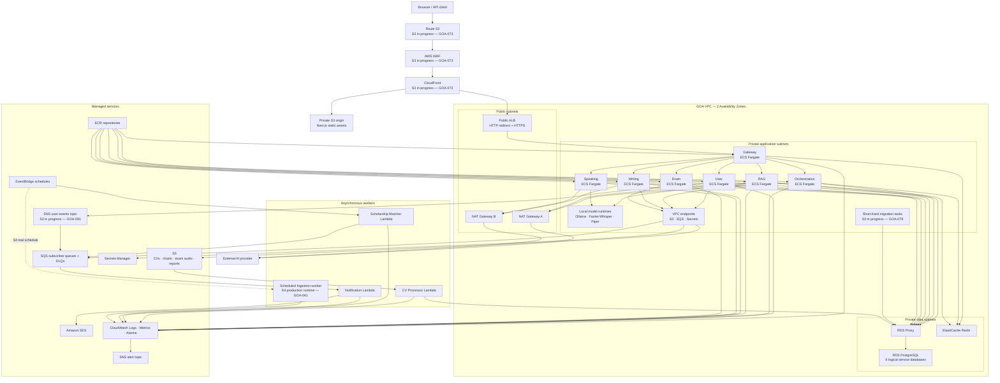
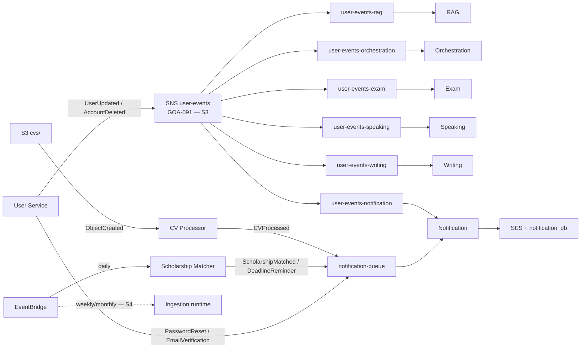
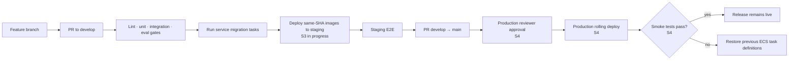

# GOA AWS Architecture

**Architecture baseline:** Mid-Sprint 3

**Last reviewed:** 2026-07-27

**Normative sources:**

- `../../Docs/GOA_Sprint_1_Tickets.md`
- `../../Docs/GOA_Sprint_2_Tickets.md`
- `../../Docs/GOA_Sprint_3_Tickets.md`
- `../../Docs/GOA_Sprint_4_Tickets.md`

## 1. Authority and status convention

The sprint tickets are the source of truth for intended architecture, ownership, and delivery phase. Repository code and Terraform are implementation evidence only; they do not redefine the ticketed design.

This document uses the following phase model:

| Label | Meaning |
| --- | --- |
| **S1–S2 baseline** | Architecture committed by completed Foundation and Core AI sprints. |
| **S3 in progress** | Current Integration sprint scope. A component is not considered complete until its ticket definition of done and cross-service flow pass. |
| **S4 planned** | Production-quality scope that must not be presented as current capability. |

When ticket text conflicts, an explicit later correction, warning, rescope, or downstream-impact note takes precedence over an older acceptance-criteria line. Important examples are recorded in Section 12.

## 2. Architecture evolution by sprint

| Sprint | AWS and platform outcome |
| --- | --- |
| **Sprint 1 — Foundation** | Local nine-service topology; shared contracts; CI; VPC, subnet, ALB, security-group, endpoint, RDS, Redis, SQS, Secrets Manager, IAM, logging, alarms, and remote-state Terraform modules. |
| **Sprint 2 — Core AI** | ECS task/service definitions, ECR repositories, S3 buckets, Lambda definitions, EventBridge schedules, CV object trigger, structured opportunity/visa storage, and database-per-service enforcement at the API boundary. |
| **Sprint 3 — Integration, current** | Apply and validate staging, automate deployment, run migrations before rollout, complete Gateway routing, add Notification and Scholarship Matcher workers, introduce SNS fan-out, deploy observability, and define the production edge with CloudFront, ACM, Route 53, and WAF. |
| **Sprint 4 — Production quality** | Apply production, validate worker migration, deploy the real scheduled ingestion runtime, introduce promotion gates and smoke rollback, load-test, add cost controls, and publish the day-two infrastructure runbook. |

## 3. Target AWS topology

The diagram shows the ticketed end state. Node labels identify the sprint in which the capability is introduced or completed.

## 4. Network and request routing

### 4.1 Network layout

GOA uses one environment-specific VPC across two Availability Zones:

- two public subnets contain the ALB and one NAT Gateway per AZ;
- two private application subnets contain ECS tasks and migration tasks;
- two private data subnets contain RDS, RDS Proxy, and ElastiCache;
- S3 uses a gateway endpoint;
- Secrets Manager and SQS/SNS use private interface endpoints where supported;
- no database or application container is directly internet-accessible;
- ECS Exec uses SSM rather than an SSH bastion.

### 4.2 Public edge

The Sprint 3 production-edge definition in GOA-073 is:

- `goa.app` resolves through Route 53 to CloudFront;
- CloudFront serves Next.js static assets from a private S3 origin using Origin Access Control;
- `/api/*` is forwarded without caching to the ALB;
- `api.goa.app` resolves directly to the ALB;
- ACM provides certificates, including the required `us-east-1` certificate for CloudFront;
- WAF applies managed common-threat rules, known-bad-input rules, and IP rate limiting;
- HTTP redirects to HTTPS and production enforces TLS 1.2 or newer.

The edge is defined during Sprint 3 but is not applied to production until GOA-037 in Sprint 4.

### 4.3 Gateway boundary

The Gateway is the public application boundary. It owns:

- access-JWT issuance and validation;
- refresh/logout orchestration through User internal APIs;
- Redis-backed request limiting and token revocation;
- subscription-tier enforcement;
- correlation-ID creation and forwarding;
- proxying chat, opportunity, checklist, CV, Writing, Exam, Notification, and Speaking traffic.

GOA-026 makes the Speaking WebSocket a Gateway route during Sprint 3. GOA-132 remains the Sprint 4 closure ticket if the browser still bypasses the Gateway for opportunity search or Speaking.

## 5. Compute architecture

### 5.1 ECS Fargate

The service deployment model resolves the ambiguous phrase “all nine ECS services” as follows:

| Runtime | Services |
| --- | --- |
| **Long-running ECS services** | Gateway, User, Orchestration, RAG, Writing, Speaking, Exam |
| **Lambda workers** | CV Processor, Scholarship Matcher, Notification |
| **Scheduled ingestion** | Lambda or equivalent bounded worker completed by GOA-041 |

Each long-running service has its own task definition, health check, log group, desired count, autoscaling policy, and service-specific runtime configuration. Staging scales from one to four tasks; production can scale to ten.

ECR contains repositories for the seven ECS images and three Lambda worker images. Release images are tagged with the commit SHA and the exact image tested in staging is promoted to production.

Ollama embeddings and the Faster-Whisper/Piper speech stack are private supporting runtimes rather than additional domain owners. Their ECS sidecar/service placement, CPU or GPU sizing, health checks, and scaling must be validated before production; no browser may address them directly.

### 5.2 Lambda and scheduled work

| Worker | Trigger | Responsibility |
| --- | --- | --- |
| CV Processor | S3 `ObjectCreated` under `cvs/` | Extract PDF/DOCX text and structured fields, update Writing data, publish completion. |
| Scholarship Matcher | EventBridge daily at 08:00 UTC | Diff updated scholarships, score eligible profiles without LLM fan-out, publish notifications. |
| Notification | Notification SQS queue | Send SES email and persist in-app notifications. |
| Ingestion | Weekly program and monthly visa schedules by Sprint 4 | Resume source crawls, dual-write structured data and documents, and publish reports. |

Lambda functions use container images, least-privilege roles, concurrency limits, structured logs, and CloudWatch/Lambda Insights.

## 6. Data architecture

### 6.1 PostgreSQL ownership

One RDS PostgreSQL instance is shared for cost efficiency, but it contains eight logically isolated databases:

| Database | Owner |
| --- | --- |
| `user_db` | User |
| `orchestration_db` | Orchestration |
| `rag_db` | RAG |
| `writing_db` | Writing |
| `speaking_db` | Speaking |
| `exam_db` | Exam |
| `notification_db` | Notification |
| `ingestion_db` | Ingestion |

Services never query another service’s database. Cross-service access uses internal REST calls or events. RDS Proxy protects PostgreSQL from connection spikes caused by ECS scaling and Lambda cold starts.

Sprint 3 GOA-079 introduces one short-lived migration task per database-owning service. Migrations run before the service rollout, and migration failure stops deployment.

### 6.2 Redis

Redis supports ephemeral and cached state:

- logical DB 0: Gateway rate limits, token revocation, and short subscription/session caches;
- logical DB 1: Orchestration’s 24-hour conversation window;
- a separate logical namespace/database for RAG scoring cache, as introduced by GOA-012.

Long-term conversation facts belong in `orchestration_db` under Sprint 4 GOA-038, not in Redis.

### 6.3 S3

| Bucket purpose | Contents |
| --- | --- |
| Writing files | CVs under `cvs/` and Academic Task 1 chart assets |
| Exam audio | Listening MP3s |
| Ingestion reports | Run summaries, counts, failures, and cost |
| Evaluation reports | CI and Gold Tier JSON/HTML results |
| Terraform state | Versioned remote state created by the bootstrap process |

Buckets block public access, enable versioning and SSE-S3 encryption, and expire non-current versions. Browser access to protected content uses application-controlled pre-signed URLs.

## 7. Event architecture

SNS raw delivery preserves the shared event envelope while allowing each service to consume the same user lifecycle event independently. Every subscriber queue has its own DLQ.

## 8. Deployment and promotion

The canonical branch flow comes from GOA-074 and GOA-080: develop deploys to staging; main deploys to production after approval. GOA-022’s isolated reference to deploying staging on `main` is superseded by that complete promotion design.

As recorded in the ticket audits, AWS credentials/infrastructure were not yet available when the staging workflow was paused. Until GOA-021 is complete, GOA-030 permits the Sprint 3 journeys to run through Gateway against Docker Compose.

## 9. Security and observability

### Security

- per-service IAM task roles and secrets;
- GitHub OIDC with repository-scoped trust and no static AWS keys;
- private RDS/Redis and no SSH ingress;
- Gateway JWT, tier checks, rate limits, and correlation IDs;
- WAF at the production edge;
- encrypted, private, versioned S3 buckets;
- AccountDeleted fan-out and retention controls under GOA-085;
- separate staging and production secrets.

### Observability

- structured JSON logs to one CloudWatch log group per service;
- ECS Container Insights;
- Prometheus endpoints scraped by a CloudWatch Agent sidecar or dedicated service;
- Lambda Insights for workers;
- CloudWatch dashboard for request rate, latency, errors, WebSockets, Lambda invocations, and DLQ depth;
- alarms for service health, latency, errors, Lambda failures, and any DLQ message;
- Langfuse for AI traces and user-level model cost;
- SNS delivery to the team alert channel.

## 10. Mid-Sprint 3 architecture checkpoint

The following are current-sprint completion gates, not assumed completed features:

| Area | Governing tickets | Required Sprint 3 outcome |
| --- | --- | --- |
| Staging | GOA-021, GOA-022 | Terraform applied, services healthy, changed images deployed automatically, rollback proven. |
| Database rollout | GOA-079 | Per-service migrations execute before ECS rollout and abort safely on failure. |
| Public/API routing | GOA-026, GOA-059 | Gateway covers AI and Exam traffic, ownership and tier checks are enforced. |
| Async notifications | GOA-023, GOA-024, GOA-083 | Matcher and auth events reach Notification; SES and in-app persistence are idempotent. |
| Event fan-out | GOA-091, GOA-085 | User events use SNS plus per-service SQS queues; deletion reaches every data owner. |
| Observability | GOA-027 | Langfuse works end to end; CloudWatch dashboard and alarms receive real telemetry. |
| Production edge definition | GOA-073 | CloudFront, ACM, Route 53, WAF, and HTTPS are fully represented in Terraform. |
| Integration proof | GOA-030 | Four real user journeys pass through the Gateway against real dependencies. |

## 11. Sprint 4 target state

Sprint 4 adds operational maturity rather than redefining service ownership:

- production apply and health validation (GOA-037);
- complete and validate the three Lambda worker paths (GOA-031);
- real resumable scheduled ingestion and freshness reporting (GOA-041);
- staging-to-production approval and same-image promotion (GOA-080);
- automatic post-deploy smoke rollback (GOA-044);
- production load testing (GOA-036);
- AWS and AI cost monitoring (GOA-046);
- infrastructure outputs and operations runbook (GOA-082);
- complete chart storage/delivery and close direct-browser routing gaps (GOA-131, GOA-132).

## 12. Ticket clarifications applied

1. **Seven ECS services, not nine long-running ECS services.** GOA-071’s detailed list places Notification and Ingestion outside ECS; the architecture uses seven ECS services and worker runtimes.
2. **CV trigger prefix is `cvs/`.** GOA-072’s old test references to `essays/` are explicitly marked stale by GOA-087.
3. **Staging deploys from develop.** GOA-074 and GOA-080 supersede GOA-022’s standalone `main` wording.
4. **User events become SNS fan-out in Sprint 3.** The Sprint 2 bare queue is the earlier single-consumer form.
5. **The weekly ingestion placeholder is not the target design.** GOA-041 supplies the real canonical ingestion worker in Sprint 4.
6. **Production is not current.** GOA-073 defines it during Sprint 3; GOA-037 applies and validates it in Sprint 4.

## 13. Ticket source map

| Concern | Primary tickets |
| --- | --- |
| Local topology and contracts | GOA-001, GOA-002 |
| Networking and stateful AWS services | GOA-069, GOA-070 |
| ECS, ECR, Lambda, EventBridge, S3 | GOA-071, GOA-072 |
| Secure branch/deployment identity | GOA-011, GOA-074 |
| Staging and automated deployment | GOA-021, GOA-022, GOA-079 |
| Gateway and Exam routing | GOA-026, GOA-059 |
| Notifications and scheduled matching | GOA-023, GOA-024, GOA-083 |
| Event fan-out and deletion | GOA-091, GOA-085 |
| Observability | GOA-027 |
| Production edge | GOA-073 |
| Production operations | GOA-031, GOA-036, GOA-037, GOA-041, GOA-044, GOA-046, GOA-080, GOA-082 |
