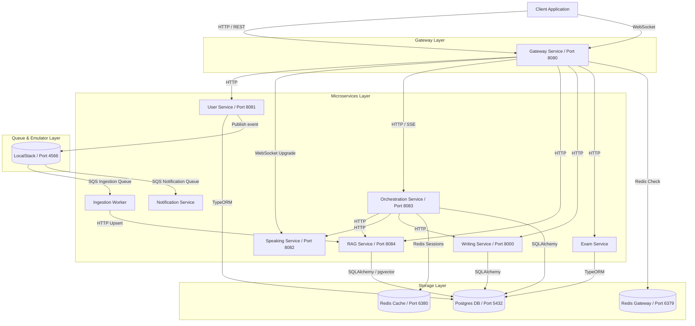

# Architecture Overview

This document describes the high-level architecture of the GOA system, showing how the 9 microservices interact, the protocols they use, their database schemas, and external service bindings.

## System Topology

The system comprises 9 services, a shared PostgreSQL instance hosting service-specific logical databases, memory caches, and local AWS emulation via LocalStack.

---

## Service Ownership & Databases

| Service Name | Language / Framework | Primary Port | Databases Owned | Event Subscriptions / SQS |
| :--- | :--- | :--- | :--- | :--- |
| **Gateway** | Go / Fiber | `8080` | `redis-gateway` (logical db 0) | N/A |
| **User Service** | TypeScript / NestJS | `8081` | `user_db` (PostgreSQL) | N/A (Publishes `user.updated`) |
| **Speaking** | Go | `8082` | N/A | N/A |
| **Orchestration** | Python / FastAPI | `8083` | `orchestration_db` (Postgres), `redis-cache` (db 1) | N/A |
| **RAG Service** | Python / FastAPI | `8084` | `rag_db` (PostgreSQL with `vector` extension) | N/A |
| **Ingestion Worker**| Python | N/A (Cron / Lambda) | N/A | `ingestion-queue` |
| **Writing** | Python / FastAPI | `8000` | `writing_db` (PostgreSQL) | N/A |
| **Exam** | TypeScript / NestJS | N/A | `exam_db` (PostgreSQL) | N/A |
| **Notification** | TypeScript / Node | N/A | N/A | `notification-queue` |

---

## Protocols Used

1. **HTTP/REST**: For synchronous operations (e.g. user authentication, document querying, internal stubs, and admin checks).
2. **WebSockets**: Long-lived bidirectional streaming connection in the **Speaking Service** to stream chunked audio payloads and return instantaneous transcripts.
3. **SSE (Server-Sent Events)**: Uni-directional downstream chunked streaming from the **Orchestration Service** to return intent classification metadata followed by real-time LLM generated tokens.
4. **SQS Message Broker**: Asynchronous event-driven communication (via LocalStack in development) for background tasks (e.g., CV Ingestion and email notifications dispatching).
