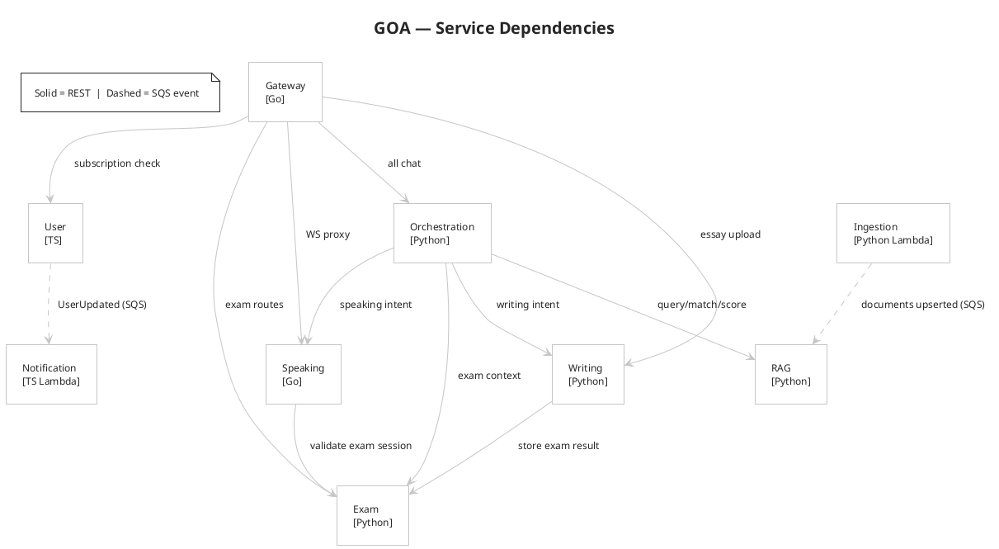

# Global Opportunity Assistant — Complete Project Documentation

> **Team:** Abdelrahman Amer, Ahmed Mohsen, Ahmed Mounir, Fady Ehab, Youssef Mohamed Esmail  
> **Industry:** EdTech / Career Services  
> **Stack:** Go · TypeScript · Python · AWS ECS Fargate · LangChain

---

## Table of Contents

1. [Project Overview](#1-project-overview)
2. [AI Architecture](#2-ai-architecture)
3. [Microservices Design](#3-microservices-design)
4. [AWS Infrastructure](#4-aws-infrastructure)
5. [Tech Stack Decisions](#5-tech-stack-decisions)
6. [Scoring System](#6-scoring-system)
7. [Data Strategy](#7-data-strategy)
8. [AI Cost Estimation](#8-ai-cost-estimation)
9. [Agile Implementation Plan](#9-agile-implementation-plan)
10. [Key Decisions & Tips](#10-key-decisions--tips)
11. [Gold Tier Checklist](#11-gold-tier-checklist)

---

## 1. Project Overview

### The Problem
Many individuals seeking work or educational opportunities abroad struggle with complex and unclear application processes — paperwork, CV preparation, language requirements. This lack of guidance leads to missed opportunities, especially for students and job seekers with limited access to reliable information.

### The Solution
The **Global Opportunity Assistant** is an intelligent app that guides users step-by-step through applying for opportunities abroad. It:
- Reviews and improves CVs
- Explains and evaluates IELTS language skills (Speaking, Writing, Reading, Listening)
- Provides a curated, personalised list of universities, scholarships, and job opportunities
- Scores each opportunity against the user's actual profile with a confidence score and gap report
- Notifies users when new scholarship cycles open

### The AI Trinity
| Layer | Technology | Role |
|---|---|---|
| **LLM (Intelligence)** | Claude claude-sonnet-4-6 / Haiku | CV analysis, IELTS evaluation, Q&A, scoring boost |
| **RAG (Knowledge)** | pgvector + LangChain | Retrieves up-to-date requirements, visa rules, scholarship info |
| **Agents (Action)** | LangChain.js + Go goroutines | 11-agent system: Supervisor + 4 Speaking + 4 Writing + 1 RAG + 1 Profile Matcher |

### Business Model
- **Free tier:** RAG-powered Q&A, opportunity search, application checklist
- **Paid tier:** CV review, Speaking practice, Writing evaluation, full profile matching with LLM boost

---

## 2. AI Architecture

```
┌──────────────────────────────────────────────────────┐
│  USER LAYER                                          │
│  React / Next.js — CV upload · Chat · Audio · Scores │
└────────────────────────┬─────────────────────────────┘
                         │ HTTPS / WebSocket
┌────────────────────────▼─────────────────────────────┐
│  GATEWAY LAYER (Go/Fiber)                            │
│  Auth · Rate limiting · Routing · Subscription check │
│                              Amazon SQS (async)      │
└────────────────────────┬─────────────────────────────┘
                         │ Internal REST
┌────────────────────────▼─────────────────────────────┐
│  ORCHESTRATION (TypeScript / LangChain.js)           │
│  Supervisor Agent — Intent classification → routing  │
│  Conversation memory (Redis, 24h TTL)                │
└──────┬──────────────┬──────────────┬─────────────────┘
       │              │              │
┌──────▼──────┐ ┌─────▼──────┐ ┌────▼────────────────┐
│  SPEAKING   │ │  WRITING   │ │  RAG + PROFILE      │
│  (Go)       │ │  (Python)  │ │  MATCHER (Python)   │
│  ─────────  │ │  ────────  │ │  ─────────────────  │
│  Fluency    │ │  Task Resp │ │  Reading agent      │
│  Lexical    │ │  Cohesion  │ │  Listening agent    │
│  Grammar    │ │  Vocabulary│ │  Profile Matcher    │
│  Pronunciat │ │  Grammar   │ │  3-stage scoring    │
│             │ │            │ │                     │
│  STT/TTS    │ │  GPT-4V    │ │  pgvector search    │
│  WebSocket  │ │  Vision AI │ │  Re-ranking         │
└──────┬──────┘ └─────┬──────┘ └────┬────────────────┘
       └──────────────┴──────────────┘
                      │
┌─────────────────────▼────────────────────────────────┐
│  RAG LAYER                                           │
│  Embedding pipeline (text-embedding-3-small, 1536d)  │
│  PostgreSQL + pgvector · PostgreSQL (profiles/users) │
└─────────────────────┬────────────────────────────────┘
                      │ Weekly scheduled scrape
┌─────────────────────▼────────────────────────────────┐
│  DATA SOURCES                                        │
│  IELTS/Cambridge PDFs · Mastersportal · DAAD         │
│  Chevening · Erasmus+ · UK/DE/CA visa portals        │
└──────────────────────────────────────────────────────┘
```

### The 11 Agents

| # | Agent | Swarm | Evaluates |
|---|---|---|---|
| 1 | Supervisor | Orchestration | Intent classification, routing, memory |
| 2 | Fluency evaluator | Speaking | Speaking fluency and coherence |
| 3 | Lexical evaluator | Speaking | Vocabulary range and accuracy |
| 4 | Grammar evaluator | Speaking | Grammatical range and accuracy |
| 5 | Pronunciation evaluator | Speaking | Pronunciation clarity |
| 6 | Task response evaluator | Writing | Task achievement and addressing the prompt |
| 7 | Cohesion evaluator | Writing | Coherence and cohesion of ideas |
| 8 | Vocabulary evaluator | Writing | Lexical resource |
| 9 | Grammar evaluator | Writing | Grammatical range and accuracy |
| 10 | Reading/Listening agent | RAG | IELTS reading and listening Q&A |
| 11 | Profile Matcher | RAG | 3-stage opportunity scoring |

---

## 3. Microservices Design

### Database-Per-Service Rule

Each service owns its data. No service queries another service's database directly. Cross-service data access happens through:

1. **Sync REST calls** — when Service A needs data from B to complete a request (e.g. Orchestration → User service to check subscription tier). Cache results in Redis.
2. **Async SQS events** — when Service A produces something Service B reacts to independently (e.g. Scholarship Matcher → Notification service). Neither service knows about the other's database.
3. **Local snapshot** — RAG service subscribes to `UserUpdated` events and maintains a local read-optimised copy of profile fields needed for scoring. Avoids synchronous calls on every scoring request.

**Never:** direct cross-schema SQL queries between services.

### Service Map

| Service | Language | Framework | Own Database | Responsibility |
|---|---|---|---|---|
| Gateway | **Go** | Fiber v2 | Redis (rate limits) | Auth, routing, rate limiting, WebSocket proxying, subscription enforcement |
| User service | **TypeScript** | NestJS + TypeORM | PostgreSQL | User registration, profile CRUD, subscription state, publishes UserUpdated events |
| Orchestration | **TypeScript** | NestJS + LangChain.js | Redis (session memory) | Supervisor Agent, intent routing, conversation memory |
| Speaking | **Go** | Gorilla WebSocket | PostgreSQL (sessions) | WebSocket audio pipeline, Whisper STT, 4 speaking agents, ElevenLabs TTS streaming |
| Writing | **Python** | FastAPI | PostgreSQL + S3 | Essay/CV upload, GPT-4V extraction, 4 writing agents, CV review |
| RAG service | **Python** | FastAPI + LangChain | PostgreSQL + pgvector | Vector search, Q&A, profile matching, 3-stage scoring |
| Notification | **TypeScript** | AWS Lambda | PostgreSQL (alerts) | Email via SES, in-app alerts, consumes SQS notification-queue |
| Ingestion worker | **Python** | AWS Lambda / ECS | PostgreSQL (crawl state) | Weekly scraping, chunking, embedding, scholarship diff + match notifications |

### SQS Event Contracts

```typescript
// All events extend BaseEvent
interface BaseEvent {
  type: string;
  version: '1.0';
  timestamp: string;   // ISO 8601
  correlationId: string;
}

interface UserUpdated extends BaseEvent {
  type: 'user.updated';
  payload: { userId: string; updatedFields: string[]; profileSnapshot: UserProfile; }
}

interface CVUploaded extends BaseEvent {
  type: 'cv.uploaded';
  payload: { userId: string; s3Key: string; fileName: string; }
}

interface ScholarshipMatched extends BaseEvent {
  type: 'scholarship.matched';
  payload: { userId: string; programId: string; score: number; deadline: string; }
}
```

---

## 4. AWS Infrastructure

### Network Architecture

```
INTERNET EDGE
  Route 53 (DNS) → CloudFront CDN → WAF
                        │
                        ▼
  ┌─── AWS VPC ──────────────────────────────────────┐
  │                                                  │
  │  PUBLIC SUBNET                                   │
  │  Application Load Balancer (HTTPS termination)  │
  │  NAT Gateway (outbound from private subnet)      │
  │                                                  │
  │  PRIVATE SUBNET — ECS Fargate Cluster           │
  │  ┌────────┐ ┌──────┐ ┌─────────────┐           │
  │  │Gateway │ │ User │ │Orchestration│           │
  │  └────────┘ └──────┘ └─────────────┘           │
  │  ┌─────────┐ ┌────────┐ ┌─────┐               │
  │  │Speaking │ │Writing │ │ RAG │               │
  │  └─────────┘ └────────┘ └─────┘               │
  │                                                  │
  │  PRIVATE SUBNET — Data Tier                     │
  │  RDS PostgreSQL · ElastiCache Redis             │
  │  Amazon S3 · Amazon SQS                         │
  │                                                  │
  │  LAMBDA FUNCTIONS (serverless workers)          │
  │  CV Processor (S3 trigger)                      │
  │  Scholarship Matcher (EventBridge daily cron)   │
  │  Notification sender (SQS trigger)              │
  └──────────────────────────────────────────────────┘
  
EXTERNAL AI APIs (via NAT Gateway)
  Claude API · OpenAI (Whisper + GPT-4V) · ElevenLabs
```

### Local → Cloud Migration Path

| Week | Environment | What's happening |
|---|---|---|
| Week 1 | **Local only** | Docker Compose, all services + LocalStack (SQS/S3 emulator). No AWS costs. One developer sets up `docker-compose.yml` on Day 1 — this unblocks the team. |
| Week 2 | **Staging on AWS** | One developer provisions ECS cluster, RDS, Redis, SQS. CI/CD pipeline live — pushes on merge to main. Others still develop locally. |
| Week 3 | **Full cloud integration** | All services on staging ECS. Staging E2E tests run automatically. CloudWatch + Langfuse observability live. |
| Week 4 | **Production + Lambda migration** | Production environment. CloudFront, WAF, Route 53. Async workers converted to Lambda. Blue/green deployment. Smoke tests after every deploy. |

**The golden rule:** if it runs in Docker Compose locally, it runs on ECS. Same Docker image, same env vars — only the destination changes.

### Monthly Cost Estimate (Demo Scale)

| Service | Config | Est. $/month |
|---|---|---|
| ECS Fargate (5 services) | 0.25 vCPU / 0.5GB each | ~$20–35 |
| RDS PostgreSQL | db.t3.micro | ~$15 |
| ElastiCache Redis | cache.t3.micro | ~$12 |
| Application Load Balancer | Standard | ~$16 |
| S3 + data transfer | Low volume | ~$2 |
| Lambda (3 workers) | Infrequent | <$1 |
| SQS + EventBridge | Low volume | <$1 |
| Secrets Manager | ~8 secrets | ~$3 |
| **AWS Total** | | **~$70–85/month** |

---

## 5. Tech Stack Decisions

### Language Selection Rationale

**Go for Gateway and Speaking:**
- Gateway: high-throughput HTTP routing, Redis rate limiting, JWT validation — no AI libraries needed. Fiber v2 is Express-like but significantly faster.
- Speaking: Go's goroutine model is purpose-built for WebSocket concurrency. Each connection gets a goroutine at ~2KB memory vs Node's event loop. The 3-second P95 latency target is achievable in Go; it's a stretch in Node.

**TypeScript for User service only:**
- Standard CRUD with TypeORM and NestJS — well-suited for TypeScript.
- Keeps type contracts shared with Gateway via the `/packages/contracts` package.

**Python for Orchestration (and all AI services):**
- LangChain Python is significantly more mature than LangChain.js — gets new features first, better documentation, more community support.
- Consistent with RAG service, Writing service, and all async workers. Developers owning the AI layer stay in one language.
- Inter-service contracts are validated via Pydantic models in `/packages/contracts/py` — no need to share TypeScript types.

**Python for everything AI and data:**
- LangChain Python, `sentence-transformers`, `pgvector` client, `PyMuPDF`, `spaCy`, `Playwright`, `numpy` — all significantly more mature than JS equivalents.
- The Writing service (GPT-4V multimodal), RAG service (embeddings, scoring math), and all async workers belong in Python.

**TypeScript Lambda for Notification:**
- Simple event consumer. No performance or AI requirements. TypeScript Lambda is fast to build and reason about.

### AI Model Selection

| Use case | Model | Rationale |
|---|---|---|
| RAG Q&A (free tier) | Claude Haiku 4.5 | $0.80/$4.00 per M tokens. Fast. Good for retrieval-augmented answers. |
| Speaking evaluation (4 agents, parallel) | Claude Sonnet 4.6 | Quality needed for accurate IELTS band scoring. Runs concurrently in goroutines. |
| Writing evaluation (4 agents, parallel) | Claude Sonnet 4.6 | Structured JSON output mode for reliable band + feedback format. |
| CV review agent | Claude Sonnet 4.6 | Complex multi-section analysis with country-specific rules. |
| LLM contextual boost (scoring Stage 3) | Claude Haiku 4.5 | Returns a single integer. Haiku is more than capable. Cost: ~$0.002/call. |
| Essay image extraction | GPT-4V (OpenAI) | Best-in-class handwritten text recognition. |
| Speech-to-text | OpenAI Whisper | $0.006/min. Most accurate STT. Transcript in <1.5s for IELTS answers. |
| Text-to-speech | ElevenLabs | Most natural-sounding conversational TTS. Supports streaming — first audio chunk before full response generated. |
| Embeddings | text-embedding-3-small | 1536 dimensions. $0.02/M tokens. Cost-effective for ingestion pipeline. |

---

## 6. Scoring System

The Profile Matcher uses a **3-stage hybrid scoring pipeline**. Hard gates eliminate ineligible programs instantly. Soft weighted scoring ranks eligible programs. An LLM contextual boost adjusts for CV quality and narrative fit.

### Stage 1 — Hard Gates (Deterministic, Zero Token Cost)

Run as pure TypeScript/Python boolean checks. If any gate fails, pipeline stops immediately and returns `score: 0` with a specific `blockedBy` reason.

| Gate | Check | User-fixable? |
|---|---|---|
| ECTS Credits | `user.ects >= program.min_ects` | Yes — take more courses |
| Degree Level | `user.degree_level ∈ program.accepted_degrees` | Yes — complete degree |
| Citizenship | `user.citizenship ∈ program.eligible_citizenships` | Rarely |
| Age limit | `user.age <= program.max_age` (if set) | No |
| Prerequisites | `required_subjects ⊆ user.completed_subjects` | Yes |

```python
def check_hard_gates(profile, program) -> GateResult:
    if profile.ects < program.min_ects:
        return GateResult(passed=False, 
            reason=f"ECTS {profile.ects} below minimum {program.min_ects}")
    if profile.degree_level not in program.accepted_degrees:
        return GateResult(passed=False, reason="Degree level not accepted")
    if profile.citizenship not in program.eligible_citizenships:
        return GateResult(passed=False, reason="Citizenship not eligible")
    return GateResult(passed=True)
```

### Stage 2 — Weighted Soft Score (Deterministic, Zero Token Cost)

Each factor normalised to 0–100 and multiplied by its weight. Weights are configurable per program type.

| Factor | Default Weight | Normalisation |
|---|---|---|
| GPA / Grade | 30% | Scale to 0–100 based on program's grading system |
| IELTS Band | 25% | `(band / 9) × 100` |
| Work / Research Experience | 25% | Years → 0–100 via sigmoid curve |
| Extracurriculars / Publications | 20% | 0–100 based on quantity + quality heuristic |

### Stage 3 — LLM Contextual Boost (−10 to +10)

Single LLM call using Claude Haiku. Reads full CV and SOP → returns integer adjustment with justification.

- **Positive (+3 to +10):** Strong research trajectory, relevant publications, compelling narrative fit
- **Negative (−3 to −10):** Generic CV, unrelated background, contradictions in personal statement

The ±10 ceiling is intentional: the boost influences borderline cases but cannot override a clear structural mismatch.

### Final Score Formula

```
final_score = min(100, max(0, round(stage2_weighted_sum + stage3_boost)))

Example:
  Stage 1: PASS
  Stage 2: (72 × 0.30) + (78 × 0.25) + (50 × 0.25) + (40 × 0.20)
         = 21.6 + 19.5 + 12.5 + 8.0 = 61.6
  Stage 3: +5 (strong research fit)
  Final:   round(61.6 + 5) = 67 → "Moderate match"
```

### Score Bands

| Score | Label | UX treatment |
|---|---|---|
| 0 (gate failure) | **Blocked** | Red banner, specific reason, fixable flag |
| 1–59 | **Weak match** | Orange card, gap report prominent |
| 60–79 | **Moderate match** | Yellow-green card, gap report secondary |
| 80–100 | **Strong match** | Green card, prompt shifts to SOP quality |

> **Design rule:** Never show sub-scores to users — only the final confidence score and the gap list. Sub-scores invite gaming. The gap list tells users what to actually fix.

---

## 7. Data Strategy

### The Right Mental Model

This project doesn't need big data — it needs **high-quality, authoritative documents**. Target 100–300 chunked documents for the initial corpus. That's sufficient for a strong demo.

### Data Sources

| Data type | Source | Update frequency |
|---|---|---|
| IELTS rubrics & band descriptors | Cambridge IELTS books 1–18 + ielts.org official PDFs | One-time (rarely changes) |
| University admission requirements | mastersportal.eu, daad.de, timeshighereducation.com | Monthly scrape |
| Visa requirements | UK gov.uk, Germany make-it-in-germany.com, Canada canada.ca | Monthly scrape |
| Scholarship listings | scholars4dev.com, erasmus.eu, chevening.org | Weekly check (deadline-sensitive) |
| CV benchmarks (for testing) | Kaggle "Resume Dataset" (2,400+ labeled resumes) | One-time |

### Ingestion Pipeline

```
Official Sources
      │
      ▼
SourceAdapter.scrape() → list[Document]
      │
      ▼
Content hash check (skip if unchanged)
      │
      ▼
RecursiveCharacterTextSplitter
  chunk_size=500, overlap=50
      │
      ▼
text-embedding-3-small (batched, 100/call)
      │
      ▼
pgvector upsert (ON CONFLICT DO UPDATE)
```

### Why No Live MCP Scraper

Requirements change once a year at most. On-demand live scraping adds latency, fragility (sites go down), and complexity for no real benefit. The scheduled weekly re-scrape + local vector DB is simpler, cheaper, and more reliable.

The one useful MCP tool: `check_scholarship_deadlines` — queries **your own PostgreSQL** (not external sites) when a user asks "are there scholarships open right now for me?"

### Scholarship Notification Architecture

```
EventBridge daily cron
      │
      ▼
Scholarship Matcher Lambda
  → Query: programs updated in last 24h
  → For each: score against all matched-country user profiles (hard gates only)
  → If score > 60 AND not previously notified: publish ScholarshipMatched event
      │
      ▼
SQS notification-queue
      │
      ▼
Notification Lambda
  → Send email via SES
  → Store in-app notification
```

---

## 8. AI Cost Estimation

### Per-Session Cost Breakdown

| Feature | Tier | Approx. cost | Main driver |
|---|---|---|---|
| RAG chat (8 queries) | Free | ~$0.005 | Haiku tokens |
| CV review (2 rewrites) | Paid | ~$0.10 | Sonnet input (long CV context) |
| Writing evaluation (2 essays) | Paid | ~$0.09 | GPT-4V + Sonnet for 4 agents |
| Speaking practice (10 min) | Paid | ~$0.15 | ElevenLabs TTS is dominant cost |
| **Full paid session** | Paid | **~$0.30–0.35** | |

### Model Pricing Reference (May 2026)

| Model | Input /M tokens | Output /M tokens |
|---|---|---|
| Claude Haiku 4.5 | $0.80 | $4.00 |
| Claude Sonnet 4.6 | $3.00 | $15.00 |
| GPT-4o (vision) | $2.50 | $10.00 |
| Whisper STT | $0.006/min | — |
| ElevenLabs TTS | $0.30/1k chars | — |
| text-embedding-3-small | $0.02/M tokens | — |

### Pricing Recommendation

At $0.30–0.35 per full session, a $5–8/month subscription gives a 3–4× margin at 4 sessions/user/month. The free tier (RAG only) costs under $0.01/session and sustains a large base cheaply.

**Cost control rules:**
- Speaking: 5-min cap for free users, 30-min for paid
- CV review: 1 rewrite/day for free tier
- Vision AI (GPT-4V): cache results — same image submitted twice returns cached evaluation
- Token tracking: Langfuse set up in Week 1, not Week 4

---

## 9. Agile Implementation Plan

### Overview

- **4 sprints, 4 weeks, 47 tickets**
- **5 developers working in parallel** — dependencies called out explicitly
- **Each sprint ships:** working features + tests + evals + deployment
- **Definition of Done per ticket:** code written + unit tests passing + CI green + PR reviewed + deployed to staging

---

### Sprint 1 — Foundation (Week 1)
**Goal:** Skeleton runs end-to-end locally. Every service starts, passes health checks, and a basic chat round-trip works on localhost.

| Ticket | Type | Priority | Title | Deps |
|---|---|---|---|---|
| GOA-001 | INFRA | P1 | Bootstrap monorepo and docker-compose.yml | — |
| GOA-002 | INFRA | P1 | Shared event schema contracts package | GOA-001 |
| GOA-003 | BE (Go) | P1 | Gateway service scaffold — Fiber + JWT auth | GOA-001 |
| GOA-004 | BE (TS) | P1 | User service scaffold — NestJS + TypeORM | GOA-001, GOA-002 |
| GOA-005 | BE (Py) | P1 | Orchestration service scaffold — Supervisor Agent | GOA-001, GOA-002, GOA-003 |
| GOA-006 | BE (Py) | P1 | RAG service scaffold — FastAPI + pgvector | GOA-001, GOA-002 |
| GOA-007 | BE (Go) | P1 | Speaking service scaffold — WebSocket + Whisper | GOA-001 |
| GOA-008 | BE (Py) | P2 | Writing service scaffold — FastAPI + S3 + GPT-4V | GOA-001, GOA-002 |
| GOA-009 | FE (TS) | P2 | Next.js frontend scaffold — chat UI shell + routing | GOA-003 |
| GOA-010 | DATA (Py) | P2 | Ingestion worker scaffold — scraper framework + chunking | GOA-006 |
| GOA-011 | TEST | P1 | CI pipeline — GitHub Actions per-service test runs | GOA-001 |

**Critical path:** GOA-001 → GOA-002 → GOA-003 → GOA-005 (Orchestration needs Gateway running)

**Sprint 1 exit criteria:** `docker-compose up` → all 8 health endpoints respond → `curl /api/chat` returns a RAG answer

---

### Sprint 2 — Core AI Features (Week 2)
**Goal:** All AI features working end-to-end locally. Full agent swarms operational. First real data ingested.

| Ticket | Type | Priority | Title | Deps |
|---|---|---|---|---|
| GOA-012 | AI (Py) | P1 | Profile Matcher Agent — 3-stage scoring pipeline | GOA-006, GOA-004 |
| GOA-013 | AI (Go) | P1 | Speaking swarm — 4 IELTS evaluation agents | GOA-007 |
| GOA-014 | AI (Py) | P1 | Writing swarm — 4 evaluation agents | GOA-008 |
| GOA-015 | DATA (Py) | P1 | Real data source adapters — IELTS, universities, scholarships | GOA-010, GOA-006 |
| GOA-016 | BE (TS) | P2 | User service — publish UserUpdated events to SQS | GOA-004, GOA-002 |
| GOA-017 | BE (Py) | P2 | RAG service — consume UserUpdated events, local snapshot | GOA-016, GOA-006 |
| GOA-018 | BE (Py) | P2 | Orchestration — wire all downstream service calls | GOA-005, GOA-012, GOA-013 |
| GOA-019 | FE (TS) | P2 | Chat UI — SSE streaming, CV upload, speaking interface | GOA-009, GOA-018 |
| GOA-020 | TEST | P1 | E2E evaluation suite — RAG quality + scoring accuracy | GOA-012, GOA-013, GOA-014, GOA-015 |

**Critical path:** GOA-015 must complete early — all AI quality depends on real data being in the vector DB.

**Sprint 2 exit criteria:** full chat journey works on localhost → RAG answers real IELTS questions → Speaking evaluation returns band scores → Scoring correctly blocks on failed ECTS

---

### Sprint 3 — Integration + Staging (Week 3)
**Goal:** All services integrated, staging environment live, E2E tests passing, evaluation pipeline running in CI.

| Ticket | Type | Priority | Title | Deps |
|---|---|---|---|---|
| GOA-021 | INFRA | P1 | AWS staging — ECS Fargate, RDS, ElastiCache, SQS | GOA-011 + all services |
| GOA-022 | INFRA | P1 | CI/CD — automated staging deployment pipeline | GOA-021, GOA-011 |
| GOA-023 | BE (TS) | P2 | Notification service — Lambda + SES + in-app alerts | GOA-021, GOA-002 |
| GOA-024 | DATA (Py) | P2 | Scholarship matcher worker — diff engine + notification trigger | GOA-017, GOA-012, GOA-023 |
| GOA-025 | BE (Py) | P2 | CV review agent — LLM-powered structured analysis | GOA-008, GOA-015 |
| GOA-026 | BE (Go) | P2 | Gateway — all routes + subscription tier enforcement | GOA-003, GOA-004, GOA-021 |
| GOA-027 | INFRA | P1 | Observability — Langfuse tracing + CloudWatch dashboards | GOA-021, GOA-018 |
| GOA-028 | TEST | P1 | LLM-as-a-Judge — Writing and Speaking accuracy pipeline | GOA-013, GOA-014, GOA-020 |
| GOA-029 | FE (TS) | P2 | User profile page — scores, opportunity matches, CV upload | GOA-019, GOA-012, GOA-025 |
| GOA-030 | TEST | P2 | Staging E2E integration test suite — 4 full user journeys | GOA-021, GOA-019, GOA-029 |

**Sprint 3 exit criteria:** staging URL live → all 4 E2E journeys pass in CI → Langfuse shows agent traces → LLM-as-a-Judge accuracy ≥80%

---

### Sprint 4 — Production Quality + Gold Tier (Week 4)
**Goal:** Production deployed, load tests pass, security guardrails in place, Gold Tier documentation complete, demo-ready.

| Ticket | Type | Priority | Title | Deps |
|---|---|---|---|---|
| GOA-031 | INFRA | P1 | Lambda migration — CV processor, scholarship matcher, notification | GOA-021, GOA-023, GOA-024 |
| GOA-032 | BE (Go) | P1 | Speaking service — latency optimisation for <3s P95 | GOA-013, GOA-021 |
| GOA-033 | BE (Py) | P2 | RAG quality improvements — re-ranking, citations, confidence threshold | GOA-006, GOA-015 |
| GOA-034 | BE (all) | P1 | Security hardening — OWASP LLM Top 10 guardrails | GOA-026, GOA-018 |
| GOA-035 | FE (TS) | P2 | Application checklist feature — personalised step-by-step guide | GOA-029, GOA-012 |
| GOA-036 | TEST | P1 | Performance load test — system-wide stress test on staging | GOA-030, GOA-032 |
| GOA-037 | INFRA | P2 | Production environment — domain, SSL, WAF, CloudFront | GOA-021, GOA-022 |
| GOA-038 | AI (Py) | P2 | Conversation memory — long-term user context across sessions | GOA-005, GOA-018 |
| GOA-039 | FE (TS) | P3 | Subscription + payment flow — Stripe integration | GOA-029, GOA-004 |
| GOA-040 | TEST | P1 | Gold Tier evaluation — full rubric self-assessment + documentation | GOA-027, GOA-028, GOA-034, GOA-036 |
| GOA-041 | DATA (Py) | P3 | Data freshness — weekly re-ingestion + change detection | GOA-015, GOA-031 |
| GOA-042 | FE (TS) | P3 | Speaking interface polish — waveform visualiser + session history | GOA-019, GOA-013 |
| GOA-043 | FE (TS) | P3 | Writing interface polish — colour-coded feedback + diff view | GOA-019, GOA-014 |
| GOA-044 | TEST | P2 | Regression smoke tests — auto-run on every production deploy | GOA-022, GOA-037 |
| GOA-045 | BE (Py) | P3 | Opportunity guide — curated FAQ with zero-token Q&A | GOA-006, GOA-033 |
| GOA-046 | INFRA | P3 | Cost monitoring — AWS Cost Explorer alerts + tagging | GOA-037 |
| GOA-047 | TEST | P3 | Demo environment — seeded data + walkthrough script | GOA-040 |

**Sprint 4 exit criteria:** production URL live → load test P95 latencies met → OWASP guardrails tested → Gold Tier documentation complete → 10-minute demo script rehearsed

---

## 10. Key Decisions & Tips

### Architecture Decisions

#### ⚠ Speaking latency is your biggest risk
The 3-second P95 target with WebSocket + STT + 4 agents + TTS is tight. The fix is **streaming**: start sending ElevenLabs audio as LLM tokens arrive — don't wait for the full response. Use Anthropic's streaming API, pipe tokens to TTS with a 20-token buffer. Test this in Week 1, not Week 3.

#### ⚠ DevOps tax will eat sprint time
One developer sets up `docker-compose.yml` on Day 1 — this unblocks the entire team. Don't touch AWS in Week 1. The golden rule: same Docker image, same env vars, different destination.

#### ✓ Skip the live MCP scraper
Most data doesn't change week-to-week. A scheduled weekly scrape into the vector DB is the right architecture. Live scraping adds latency, fragility, and complexity for no real benefit.

#### ✓ Database-per-service enforcement
One PostgreSQL instance with separate schemas per service. Enforce ownership in code — no cross-schema queries. Gives architectural correctness without the operational cost of 8 separate RDS instances.

#### Go for two services only
Go is excellent for Speaking (WebSocket concurrency) and Gateway (high-throughput routing). Don't extend Go to services that depend on the Python AI ecosystem.

### Scoring System Tips

- **Never show sub-scores** — only final confidence score + gap list
- **Hard gates run first** — zero tokens, zero cost, microseconds. Never waste an LLM call on a program that fails ECTS.
- **LLM boost ceiling is intentional** — ±10 can influence borderline cases but cannot override a structural mismatch
- **Cache aggressively** — Redis TTL 1 hour for `score:{userId}:{programId}`

### Common Pitfalls

| Pitfall | Mitigation |
|---|---|
| Starting on AWS directly | Always local-first. AWS debugging is slow and costly. |
| Building all 11 agents in Week 1 | Sprint 1: Supervisor routes to one working service. Agents added incrementally. |
| Watching costs in Week 4 | Set up Langfuse token tracking in Week 1. Set per-user daily limits early. |
| Storing JWT in localStorage | Use httpOnly cookies (set by Gateway). Never localStorage — XSS vulnerable. |
| Cross-service DB queries | Only REST calls or SQS events. Never `SELECT * FROM another_service_schema.table`. |

---

## 11. Gold Tier Checklist

- [ ] **5+ agents with hierarchical orchestration** — Supervisor Agent routing to 4 specialist swarms (11 agents total). Document each agent in Langfuse traces with screenshots.
- [ ] **LLM-as-a-Judge automated scoring** — Claude Sonnet evaluates Writing and Speaking outputs against official IELTS rubrics. Target: >80% ACCURATE verdicts. Runs in CI on every PR.
- [ ] **Observability** — Every LLM call and agent handoff traced in Langfuse with model, tokens, latency, cost. CloudWatch dashboards for system metrics. Screenshots as evidence.
- [ ] **Security guardrails** — OWASP LLM Top 10: prompt injection defence, PII detection in outputs, system prompt leakage prevention, per-user rate limits. Document test results.
- [ ] **RAG quality metrics** — >80% accuracy on 50-question golden dataset. Source citations on all answers. Confidence threshold refusing answers below 0.6 similarity score.
- [ ] **Multimodal input** — Vision AI for handwritten essay images (GPT-4V). Audio input/output for speaking practice (Whisper + ElevenLabs). Both working end-to-end in production.
- [ ] **Performance** — Speaking P95 latency <3s. Load test: 100 concurrent RAG users + 20 concurrent speaking sessions passing. Results documented.
- [ ] **Freemium model** — Free tier (RAG + checklist) functional and demonstrably cheaper to serve. Paid tier gate enforcement tested. Stripe integration working in test mode.

---

*Generated from architecture discussions. Last updated: Sprint planning session.*

---

## 12. Monitoring & Observability

> Observability is a Week 1 foundation, not a Week 4 retrofit. Add Langfuse SDK calls the moment you write the first LLM call. Add Prometheus metrics the moment you write the first endpoint.

### Observability Stack

| Tool | Purpose | Set up in |
|---|---|---|
| Langfuse | LLM traces — every agent call, token count, cost, latency | Sprint 1 with GOA-005, GOA-006 |
| OpenTelemetry | Distributed traces — X-Correlation-ID through all hops | Sprint 1 with GOA-003 |
| Prometheus | Per-service metrics at `/metrics` — scraped by CloudWatch | Sprint 1 per service |
| Grafana | Local dashboard in docker-compose — Prometheus data source | Sprint 1 (GOA-001) |
| CloudWatch Logs | Structured JSON logs from ECS and Lambda | Sprint 3 (GOA-021) |
| CloudWatch Alarms | P95 latency, error rate, DLQ depth alerts | Sprint 3 (GOA-027) |
| AWS Lambda Insights | Cold start time, memory, duration per invocation | Sprint 4 (GOA-031) |

---

### Required Metrics Per Service

#### Gateway (Go)

| Metric | Type | Alert threshold |
|---|---|---|
| `goa_gateway_requests_total` | Counter (route, method, status_code) | Error rate > 1% over 5 min |
| `goa_gateway_latency_seconds` | Histogram — buckets at 50ms/100ms/200ms/500ms/1s/5s | P95 > 500ms |
| `goa_gateway_rate_limit_hits_total` | Counter (user_id) | Single user > 10 hits/min |
| `goa_gateway_auth_failures_total` | Counter | > 50/min → possible brute force |
| `goa_gateway_upstream_errors_total` | Counter (by service) | > 5 consecutive → circuit open |

Every request log line must include: `{request_id, user_id, route, status, latency_ms, upstream_service}` as structured JSON via zerolog. X-Correlation-ID generated on every request if absent and propagated to all downstream calls.

#### Speaking service (Go)

| Metric | Type | Target / Alert |
|---|---|---|
| `goa_speaking_active_connections` | Gauge | Alert if > 80 (near 100 max) |
| `goa_speaking_transcription_ms` | Histogram | P95 < 1500ms |
| `goa_speaking_llm_first_token_ms` | Histogram | P95 < 800ms |
| `goa_speaking_tts_first_audio_ms` | Histogram | P95 < 600ms |
| `goa_speaking_e2e_latency_ms` | Histogram | **P95 < 3000ms (hard SLO)** |
| `goa_speaking_agent_band_score` | Histogram (by criterion) | Monitor for scoring drift |
| `goa_speaking_sessions_total` | Counter (completed/dropped/error) | Drop rate > 5% → alert |
| `goa_speaking_goroutine_count` | Gauge — updated every 5s via runtime.NumGoroutine() | Alert if growing unbounded |
| `goa_speaking_slo_violations_total` | Counter | Must be 0 during demo — Gold Tier evidence |

Latency budget enforced in code: transcription_ms > 1500 → WARN log; e2e_latency_ms > 3000 → ERROR log + increment `goa_speaking_slo_violations_total`.

Session close structured log: `{session_id, user_id, duration_s, transcription_ms, goroutines_at_close, outcome}`

#### Orchestration service (Python)

| Metric | Type | Target / Alert |
|---|---|---|
| `goa_orchestration_intent_classified_total` | Counter (by intent) | Track distribution |
| `goa_orchestration_classification_latency_ms` | Histogram | P95 < 500ms |
| `goa_orchestration_downstream_latency_ms` | Histogram (by service) | Any service P95 > 5000ms → alert |
| `goa_orchestration_circuit_breaker_state` | Gauge (0=closed, 1=open, by service) | Alert immediately if any opens |
| `goa_orchestration_memory_hit_rate` | Gauge | Redis miss rate > 20% → investigate |

Langfuse root trace per request: `user_id`, `session_id`, `correlation_id`. Child span per intent classification LLM call: model, input/output tokens, latency_ms, cost_usd, classified_intent. Token budget target: < 2000 tokens per request.

Circuit breaker structured logs: on open → ERROR `{service, failure_count, opened_at, correlation_id}`; on close → INFO `{service, closed_at, downtime_s}`.

#### RAG service (Python)

| Metric | Type | Target / Alert |
|---|---|---|
| `goa_rag_query_latency_ms` | Histogram (cache_hit label) | P95 < 2000ms |
| `goa_rag_retrieval_similarity_score` | Histogram | P50 > 0.65 |
| `goa_rag_low_confidence_total` | Counter | Alert if refusal rate > 30% |
| `goa_rag_cache_hit_rate` | Gauge | Target > 40% |
| `goa_scoring_hard_gate_blocks_total` | Counter (by gate_type) | Track which gates block most users |
| `goa_scoring_latency_ms` | Histogram (by stage: stage1/stage2/stage3) | Stage 1 <5ms, Stage 2 <10ms, Stage 3 <800ms |
| `goa_scoring_boost_value` | Histogram | Track LLM boost value distribution over time |

Langfuse trace per query: retrieval span (top_similarity_score attribute) + answer generation child span (model, tokens, cost). Stage 3 LLM boost logged as Langfuse child span with boost_value and justification_tokens.

Per-query structured log: `{correlation_id, question_hash, top_similarity, chunks_retrieved, cache_hit, answer_tokens, latency_ms}`

#### Writing service (Python)

| Metric | Type | Target / Alert |
|---|---|---|
| `goa_writing_evaluation_latency_ms` | Histogram | P95 < 30000ms |
| `goa_writing_vision_extraction_latency_ms` | Histogram | P95 < 5000ms |
| `goa_writing_agent_band_score` | Histogram (by criterion) | Monitor for scoring drift |
| `goa_writing_cache_hit_rate` | Gauge | Target > 20% |

Langfuse root trace per essay: 4 child spans (one per agent criterion) each with band_score, prompt_tokens, completion_tokens, latency_ms. Per-evaluation structured log: `{user_id, essay_id, bands, overall_band, latency_ms, from_cache, total_tokens, total_cost_usd}`

#### Ingestion worker (Python Lambda)

| Metric | Type | Target / Alert |
|---|---|---|
| `goa_ingestion_docs_processed_total` | Counter (source, outcome: success/skip/fail) | Alert if > 10% fail rate per run |
| `goa_ingestion_embedding_tokens_total` | Counter | Track cumulative cost |
| `goa_ingestion_run_duration_seconds` | Gauge | Alert if > 900s (Lambda timeout risk) |
| DLQ depth | CloudWatch | Alert immediately if > 0 |

S3 completion report per run: `{run_id, started_at, finished_at, sources: [{name, docs_processed, docs_skipped, docs_failed}], total_embedding_tokens, duration_s}`

#### Security metrics (all AI services)

| Metric | Type | Notes |
|---|---|---|
| `goa_security_injection_attempts_total` | Counter (by service) | Never log raw user input — log input_hash only |
| `goa_security_pii_redactions_total` | Counter | Incremented when PII detected in LLM output |

CloudWatch Logs Insights saved query: all `SECURITY_EVENT severity=HIGH` logs in last 24h — required Gold Tier audit trail evidence.

---

### AI Evaluation Metrics — Enforced Per Sprint

These metrics run in CI on every PR and block merge when thresholds are missed.

| Metric | Measured in | Target | Blocks merge if |
|---|---|---|---|
| RAG retrieval accuracy | Sprint 2 — GOA-020 | > 80% on 50-question golden dataset | < 70% |
| Hard gate decision accuracy | Sprint 2 — GOA-020 | 100% correct on 20 synthetic profiles | Any incorrect decision |
| Soft scoring accuracy | Sprint 2 — GOA-020 | ±5 points vs expected | Error > 10 points |
| Speaking agent accuracy | Sprint 3 — GOA-028 | > 80% within ±0.5 band of expert | < 75% |
| Writing agent accuracy | Sprint 3 — GOA-028 | > 80% within ±0.5 band of expert | < 75% |
| Speaking E2E latency P95 | Sprint 4 — GOA-036 | < 3000ms | > 4000ms |
| RAG query latency P95 | Sprint 4 — GOA-036 | < 2000ms | > 5000ms |
| Writing evaluation latency P95 | Sprint 4 — GOA-036 | < 30000ms | > 60000ms |
| System error rate under load | Sprint 4 — GOA-036 | < 1% | > 2% |
| Langfuse cost per user/day | Sprint 3+ continuous | < $1.00/user/day | > $2.00 triggers alert |

CI eval report schema: `{run_id, timestamp, git_sha, metrics: {...}, per_question: [...], regression_vs_previous: {delta_rag, delta_speaking, delta_writing}}`. Uploaded to S3 at `evals/reports/{git_sha}.json` after every run. GitHub Actions posts PR comment with pass/fail badge per metric and delta vs previous run.

LLM-as-Judge verdicts logged as Langfuse evaluation annotations on the original agent traces — linking the verdict directly to the exact LLM call that produced the band score.

---

### Observability Requirements Wired Into Tickets

The following summarises exactly what observability work is part of each ticket's acceptance criteria. These are not separate tasks — they are part of the definition of done.

| Ticket | Sprint | Observability requirement |
|---|---|---|
| GOA-001 | S1 | Prometheus clients in all Dockerfiles, Langfuse SDK in Orchestration + RAG deps, Grafana in docker-compose, all obs env vars in .env.example |
| GOA-003 | S1 | GET /metrics with goa_gateway_* counters and histograms, structured JSON logging via zerolog, X-Correlation-ID generation |
| GOA-005 | S1 | Langfuse client initialised at startup, root trace per /chat request, intent classification child span, goa_orchestration_* Prometheus metrics |
| GOA-006 | S1 | Langfuse client initialised at startup, root trace per /query, retrieval + answer generation child spans, goa_rag_* Prometheus metrics |
| GOA-007 | S1 | GET /metrics with all goa_speaking_* metrics, goroutine count gauge, structured session close log |
| GOA-012 | S2 | goa_scoring_* counters and histograms per stage, Langfuse child span for Stage 3 LLM boost, structured score log |
| GOA-013 | S2 | Langfuse root trace with 4 child agent spans per session, goa_speaking_agent_band_score histogram, SLO violation logging |
| GOA-014 | S2 | Langfuse root trace with 4 child agent spans per essay, goa_writing_* histograms, structured evaluation log |
| GOA-015 | S2 | goa_ingestion_* counters, S3 completion report, CloudWatch alarm for fail rate > 10% |
| GOA-018 | S2 | goa_orchestration_downstream_latency_ms and circuit_breaker_state metrics, X-Correlation-ID in all httpx headers |
| GOA-020 | S2 | Eval report JSON with regression detection, S3 upload, GitHub PR comment with pass/fail badges |
| GOA-021 | S3 | CloudWatch Log Groups with 30-day retention, Container Insights, Prometheus scrape config, DLQ alarms |
| GOA-027 | S3 | CloudWatch GOA-Overview dashboard, 5 specific alarms (latency/error/DLQ/task count), Langfuse daily cost email, /admin/costs endpoint |
| GOA-028 | S3 | Langfuse evaluation annotations on agent traces, goa_eval_judge_accuracy gauge, regression detection vs S3 previous report |
| GOA-030 | S3 | CloudWatch custom metrics per E2E journey step, S3 test summary + Playwright traces on failure |
| GOA-031 | S4 | Lambda Insights layer on all 3 functions, structured invocation log, Lambda error rate and timeout alarms |
| GOA-032 | S4 | Latency budget code enforcement with WARN/ERROR log levels, goa_speaking_slo_violations_total counter, k6 results to S3 |
| GOA-034 | S4 | goa_security_* counters, structured security event logs with input_hash (never raw input), CloudWatch Logs Insights saved query |
| GOA-036 | S4 | k6 real-time metrics to CloudWatch, full load test report JSON, CloudWatch dashboard screenshot as Gold Tier evidence |
| GOA-040 | S4 | 5 specific evidence screenshots committed to /docs/gold-tier-evidence/: Langfuse trace, CloudWatch dashboard, eval reports, security log, SLO counter |

---

### Distributed Tracing — Full Request Lifecycle

```
Every request carries X-Correlation-ID end-to-end:

Chat request:
  Browser
    → Gateway                [goa.gateway.request — logs correlation_id, route, latency_ms]
        → Orchestration      [goa.orchestration.classify — Langfuse root trace]
            → LLM (Haiku)    [Langfuse child span: model, tokens, cost, classified_intent]
            → RAG service    [goa.rag.query — Langfuse root trace, correlation_id forwarded]
                → pgvector   [Langfuse child span: top_similarity_score]
                → LLM (Haiku)[Langfuse child span: model, tokens, cost]
        → Gateway response   [total_ms, status logged as structured JSON]

Speaking request:
  Browser (WebSocket)
    → Gateway                [goa.gateway.ws_upgrade]
        → Speaking service   [goa.speaking.session_start — Langfuse root trace]
            → Whisper API    [goa_speaking_transcription_ms histogram updated]
            → 4 LLM agents   [4 Langfuse child spans in parallel goroutines
                               each: criterion, band_score, tokens, latency_ms]
            → ElevenLabs     [goa_speaking_tts_first_audio_ms histogram updated]
        → WebSocket close    [goa_speaking_e2e_latency_ms updated;
                               if > 3000ms: ERROR log + goa_speaking_slo_violations_total++]
```

### Langfuse — What Every Trace Must Include

**Every LLM call:** model name · input tokens · output tokens · latency ms · estimated cost · prompt template name · user_id · session_id · parent trace ID

**Every agent handoff:** timestamp · source agent · target agent · intent/reason · input summary · output summary · success/failure flag

**Cost tracking rule:** tag every trace with `user_id`. Daily rollup query: sum costs by user_id. Alert if any single user exceeds $1.00/day. Set this up in Sprint 1 — retrofitting is painful.

### CloudWatch Alarms Summary

| Alarm | Metric / Source | Threshold | Action |
|---|---|---|---|
| Speaking SLO breach | goa_speaking_e2e_latency_ms P95 | > 4000ms for 5 min | SNS → team email |
| High error rate | HTTP error rate per service | > 2% for 5 min | SNS → team email |
| DLQ message received | SQS ApproximateNumberOfMessagesVisible | > 0 | Immediate SNS |
| ECS task crash | ECS running task count | < desired count | SNS → team email |
| Lambda timeout risk | CV Processor Lambda duration | > 25000ms | SNS → team email |
| Lambda error rate | Lambda error rate | > 5% for 15 min | SNS → team email |
| Ingestion failure spike | goa_ingestion_docs_processed_total fail ratio | > 10% in one run | SNS → team email |
| AI cost spike | Langfuse cost per user/day | > $1.00 | Alert in /admin/costs |

---

*Generated from architecture discussions. Last updated: Sprint planning session.*

---

## 12. Monitoring & Observability

> Observability is a Week 1 foundation, not a Week 4 retrofit. Add Langfuse SDK calls the moment you write the first LLM call. Add Prometheus metrics the moment you write the first endpoint.

### Observability Stack

| Tool | Purpose | Set up in |
|---|---|---|
| Langfuse | LLM traces — every agent call, token count, cost, latency | Sprint 1 with GOA-005, GOA-006 |
| OpenTelemetry | Distributed traces — X-Correlation-ID through all hops | Sprint 1 with GOA-003 |
| Prometheus | Per-service metrics at `/metrics` — scraped by CloudWatch | Sprint 1 per service |
| CloudWatch Logs | Structured JSON logs from ECS and Lambda | Sprint 3 (GOA-021) |
| CloudWatch Alarms | P95 latency, error rate, DLQ depth alerts | Sprint 3 (GOA-027) |
| AWS Lambda Insights | Cold start time, memory, duration per invocation | Sprint 4 (GOA-031) |

### Required Metrics Per Service

#### Gateway (Go)

| Metric | Type | Alert threshold |
|---|---|---|
| `goa_gateway_requests_total` | Counter (route, status_code) | Error rate > 1% over 5 min |
| `goa_gateway_latency_seconds` | Histogram (P50/P95/P99) | P95 > 500ms |
| `goa_gateway_rate_limit_hits_total` | Counter (userId) | Single user > 10 hits/min |
| `goa_gateway_auth_failures_total` | Counter | > 50/min → possible brute force |
| `goa_gateway_upstream_errors_total` | Counter (by service) | > 5 consecutive → circuit open |

#### Speaking service (Go)

| Metric | Type | Target / Alert |
|---|---|---|
| `goa_speaking_active_connections` | Gauge | Alert if > 80 (near 100 max) |
| `goa_speaking_transcription_ms` | Histogram | P95 < 1500ms |
| `goa_speaking_llm_first_token_ms` | Histogram | P95 < 800ms |
| `goa_speaking_tts_first_audio_ms` | Histogram | P95 < 600ms |
| `goa_speaking_e2e_latency_ms` | Histogram | **P95 < 3000ms (hard SLO)** |
| `goa_speaking_sessions_total` | Counter (completed/dropped) | Drop rate > 5% → alert |
| `goa_speaking_goroutine_count` | Gauge | Alert if growing unbounded (goroutine leak) |

#### Orchestration service (Python)

| Metric | Type | Target / Alert |
|---|---|---|
| `goa_orchestration_intent_classified_total` | Counter (by intent) | Track distribution |
| `goa_orchestration_classification_latency_ms` | Histogram | P95 < 500ms |
| `goa_orchestration_downstream_latency_ms` | Histogram (by service) | Any service P95 > 5000ms → alert |
| `goa_orchestration_circuit_breaker_state` | Gauge (0=closed, 1=open) | Alert immediately if any opens |
| `goa_orchestration_memory_hit_rate` | Gauge | Redis miss rate > 20% → investigate |
| Langfuse: supervisor trace | Trace (every request) | Token budget < 2000 tokens per request |

#### RAG service (Python)

| Metric | Type | Target / Alert |
|---|---|---|
| `goa_rag_retrieval_similarity_score` | Histogram | P50 > 0.65 |
| `goa_rag_low_confidence_total` | Counter | Alert if refusal rate > 30% |
| `goa_rag_cache_hit_rate` | Gauge | Target > 40% |
| `goa_rag_query_latency_ms` | Histogram | P95 < 2000ms |
| `goa_scoring_hard_gate_blocks_total` | Counter (by gate_type) | Track which gates block most |
| `goa_scoring_latency_ms` | Histogram (by stage) | Stage 1 <5ms, Stage 2 <10ms, Stage 3 <800ms |
| Langfuse: RAG chain trace | Trace (every query) | Haiku tokens per query < 800 |

#### Writing service (Python)

| Metric | Type | Target / Alert |
|---|---|---|
| `goa_writing_evaluation_latency_ms` | Histogram | P95 < 30000ms |
| `goa_writing_vision_extraction_latency_ms` | Histogram | P95 < 5000ms |
| `goa_writing_agent_band_distribution` | Histogram (by criterion) | Monitor for scoring drift |
| `goa_writing_cache_hit_rate` | Gauge | Target > 20% |
| Langfuse: writing swarm trace | Trace (4 child spans) | Sonnet tokens per eval < 3000 total |
| LLM-as-Judge accuracy | Eval metric (CI) | > 80% ACCURATE verdicts |

#### Ingestion worker (Python Lambda)

| Metric | Type | Target / Alert |
|---|---|---|
| `goa_ingestion_docs_processed_total` | Counter (source, outcome) | Alert if > 10% failure rate |
| `goa_ingestion_docs_skipped_total` | Counter (unchanged) | Track cache efficiency |
| `goa_ingestion_embedding_tokens_total` | Counter | Track cost per run |
| `goa_ingestion_run_duration_seconds` | Gauge | Alert if > 900s (Lambda timeout risk) |
| DLQ depth | CloudWatch | Alert immediately if > 0 |

### AI Evaluation Metrics — Enforced Per Sprint

These metrics run in CI and block merges when thresholds are missed.

| Metric | Measured in | Target | Blocks if |
|---|---|---|---|
| RAG retrieval accuracy | Sprint 2 — GOA-020 | > 80% on 50-question golden dataset | < 70% |
| Hard gate decision accuracy | Sprint 2 — GOA-020 | 100% correct on 20 synthetic profiles | Any incorrect decision |
| Soft scoring accuracy | Sprint 2 — GOA-020 | ±5 points vs expected | Error > 10 points |
| Speaking agent accuracy | Sprint 3 — GOA-028 | > 80% within ±0.5 band of expert | < 75% |
| Writing agent accuracy | Sprint 3 — GOA-028 | > 80% within ±0.5 band of expert | < 75% |
| Speaking E2E latency P95 | Sprint 4 — GOA-036 | < 3000ms | > 4000ms |
| RAG query latency P95 | Sprint 4 — GOA-036 | < 2000ms | > 5000ms |
| Writing evaluation latency P95 | Sprint 4 — GOA-036 | < 30000ms | > 60000ms |
| System error rate under load | Sprint 4 — GOA-036 | < 1% | > 2% |
| Langfuse cost per user/day | Sprint 3+ continuous | < $1.00/user/day | > $2.00 triggers alert |

### Distributed Tracing — Full Request Lifecycle

```
Every request carries X-Correlation-ID end-to-end:

Chat request:
  Browser
    → Gateway                [goa.gateway.request]
        → Orchestration      [goa.orchestration.classify]
            → LLM (Haiku)    [langfuse: supervisor.intent_classification, model, tokens, cost]
            → RAG service    [goa.rag.query]
                → pgvector   [goa.rag.vector_search, similarity_scores logged]
                → LLM (Haiku)[langfuse: rag.answer_generation, model, tokens, cost]
        → Gateway response   [total_ms, status, logged as structured JSON]

Speaking request:
  Browser (WebSocket)
    → Gateway                [goa.gateway.ws_upgrade]
        → Speaking service   [goa.speaking.session_start]
            → Whisper API    [goa.speaking.transcription_ms]
            → 4 LLM agents   [langfuse: speaking.swarm, 4 child spans in parallel
                               each span: criterion, band_score, tokens, latency_ms]
            → ElevenLabs     [goa.speaking.tts_first_chunk_ms]
        → WebSocket close    [goa.speaking.e2e_ms, slo_violation: bool]
```

### Langfuse — What Every Trace Must Include

**Every LLM call:** model name · input tokens · output tokens · latency ms · estimated cost · prompt template name · user_id · session_id · parent trace ID

**Every agent handoff:** timestamp · source agent · target agent · intent/reason · input summary · output summary · success/failure flag

**Cost tracking rule:** tag every trace with `user_id`. Daily rollup query: sum costs grouped by user_id. Alert if any single user exceeds $1.00/day.

---

## 13. Why REST and Not RPC (gRPC)

### The case for REST (why we chose it)

**Three languages, one protocol.** Go, TypeScript, and Python all have first-class HTTP clients with zero setup. Adding gRPC requires a protobuf toolchain, code generation step, and generated stubs in every language — three separate build pipelines in a 4-week project.

**SSE and WebSocket are already in play.** The Speaking service uses WebSocket and Orchestration streams via SSE. Both are HTTP-native. gRPC streaming is a different protocol that cannot share the same ALB listener without special configuration.

**AWS ALB speaks HTTP natively.** ALB routes and health-checks HTTP/1.1 and HTTP/2 out of the box. gRPC requires HTTP/2 with specific ALB target group settings and h2c support per service.

**Debugging is trivial.** Every REST call is inspectable with curl or browser DevTools. gRPC requires grpcurl or a dedicated client. During a 4-week sprint where debugging speed matters, this is a real cost.

**LangChain and AI SDKs are HTTP-native.** Anthropic, OpenAI, ElevenLabs — every AI SDK makes HTTP calls. Your services are thin wrappers. Adding gRPC transport on top adds no value.

### When gRPC would have been the right choice

- **High-frequency internal calls at scale** — 500+ calls/second between services where protobuf binary encoding saves meaningful bandwidth
- **Strict schema enforcement across many teams** — protobuf enforced at compile time, impossible to send malformed messages
- **Polyglot teams at scale** — 50+ services, dozens of teams, .proto files as the single contract

### REST vs gRPC Quick Reference

| Dimension | REST (our choice) | gRPC |
|---|---|---|
| Protocol | HTTP/1.1 or HTTP/2 | HTTP/2 only |
| Payload | JSON (human readable) | Protobuf (binary, ~5× smaller) |
| Schema enforcement | Pydantic / TypeScript types | .proto files (compile-time) |
| Streaming | SSE + WebSocket (already in use) | Native server/bidirectional streaming |
| Tooling setup | Zero | protoc + per-language codegen |
| AWS ALB support | Native | Requires h2c config per service |
| Debugging | curl / browser DevTools | grpcurl or dedicated client |
| Latency (low traffic) | Negligible difference | Negligible difference |
| Latency (high traffic) | Higher overhead | ~20–40% lower per-call overhead |
| Right for this project | **Yes** | No — overhead exceeds benefit at this scale |

**What you get instead of protobuf schema enforcement:** the `/packages/contracts` directory holds Pydantic models (Python) and TypeScript interfaces that validate every SQS event and internal API payload. This gives 95% of protobuf's safety with zero toolchain overhead.

---

*Generated from architecture discussions. Last updated after Sprint planning — Orchestration migrated to Python, observability requirements added across all sprints.*

---

## 14. Exam Preparation Section

The exam prep section adds full IELTS simulation across all 4 skills for both Academic and General Training modes. Content is sourced from Cambridge IELTS books 11–18.

### Design Principle: No AI for Reading and Listening

Reading and Listening have official answer keys — grading is binary. An LLM adds no value and introduces inconsistency. The exact-match grader is 100% accurate, instant, and costs zero tokens. Running 40 answers through an LLM would cost ~$0.05 per exam and take 5–10 seconds for no accuracy benefit.

Speaking and Writing use the existing 4-agent evaluation swarms because those skills require subjective assessment against rubrics — exactly what LLMs are good at.

### The 4 Skills

| Skill | AI | Service | Grading method | Time limit |
|---|---|---|---|---|
| Reading | None | Exam service | Exact match, case-insensitive, official answer key | 60 min (40 Q) |
| Listening | None | Exam service + S3 | Same as Reading, audio via S3 pre-signed URLs | 40 min (40 Q) |
| Speaking | 4-agent swarm | Speaking service | Fluency/Lexical/Grammar/Pronunciation, mean band | 11–14 min (3 parts) |
| Writing | 4-agent swarm | Writing service | 4 criteria, Task 1 × 0.33 + Task 2 × 0.67 | 60 min (2 tasks) |

### Exam Types

**Academic** — for undergraduate/postgraduate study applications. Complex academic texts in Reading. Graphs/charts/diagrams in Task 1 Writing.

**General Training** — for work, secondary education, or migration. Social and workplace texts in Reading. Formal/informal letter in Task 1 Writing.

### Speaking Exam Structure (Part 1/2/3)

| Part | Format | Time |
|---|---|---|
| Part 1 — Interview | 4–5 general questions, one at a time | ~4 min |
| Part 2 — Long Turn | Cue card: topic + bullet points. 60s prep, 120s speaking | ~3 min |
| Part 3 — Discussion | 4–5 abstract questions related to Part 2 | ~5 min |

Server enforces both the preparation timer and speaking timer for Part 2. Client validates visually.

### Writing Exam Structure

**Academic Task 1** (min 150 words, 20 min recommended, weight 33%) — describe a graph, chart, table, or diagram. Stimulus image delivered from S3 via pre-signed URL. Evaluated by 4-agent Writing swarm.

**General Training Task 1** (min 150 words, 20 min recommended, weight 33%) — formal or semi-formal letter. Scenario delivered as text.

**Task 2** (min 250 words, 40 min recommended, weight 67%) — essay responding to a point of view or argument. Same format for Academic and General Training.

Final Writing band = (Task1_band × 0.33) + (Task2_band × 0.67)

### Question Bank

| Source | Loaded in | Academic Reading | General Reading | Listening | Speaking cue cards | Writing prompts |
|---|---|---|---|---|---|---|
| Cambridge IELTS 14–18 | GOA-049 Sprint 1 | 20 | 20 | 20 | 80+ | 40+ |
| Cambridge IELTS 11–13 | GOA-065 Sprint 4 | +12 | +12 | +12 | +48 | +24 |
| **Total** | | **32** | **32** | **32** | **128+** | **64+** |

### New Exam Service — Database-Per-Service

The Exam service owns `exam_db` exclusively. No other service queries it directly.

**exam_db tables:** `exam_sessions`, `questions`, `answer_keys`, `exam_results`, `band_conversion_tables`

**exam S3:** listening audio MP3s, Academic Task 1 stimulus images

**Cross-service interactions:**
- Speaking service validates exam sessions via `GET /internal/sessions/:id/owner` on Exam service
- Writing service posts results via `POST /internal/sessions/:id/result` on Exam service
- Orchestration calls `GET /internal/users/:id/profile-for-recommendation` to get real exam bands for scoring

### New Tickets (GOA-048 to GOA-066)

| Ticket | Sprint | Service | Title |
|---|---|---|---|
| GOA-048 | S1 | Exam (Python) | Exam service scaffold — FastAPI + exam_db |
| GOA-049 | S1 | Exam (Python) | Cambridge IELTS content ingestion — books 14–18 |
| GOA-050 | S2 | Exam (Python) | Reading exam engine — static grading, band conversion |
| GOA-051 | S2 | Exam (Python) | Listening exam engine — S3 audio, auto-grading |
| GOA-052 | S2 | Exam (Python) | Speaking exam mode — Part 1/2/3 with AI evaluation |
| GOA-053 | S2 | Exam (Python) | Writing exam mode — Task 1/2 with AI evaluation |
| GOA-054 | S2 | Frontend (TS) | Exam shell — type selection, skill cards, timer |
| GOA-055 | S3 | Frontend (TS) | Reading exam UI — passages, all question types |
| GOA-056 | S3 | Frontend (TS) | Listening exam UI — audio player, section progression |
| GOA-057 | S3 | Frontend (TS) | Speaking exam UI — Part 1/2/3 with timers |
| GOA-058 | S3 | Frontend (TS) | Writing exam UI — dual task, word counter, stimulus |
| GOA-059 | S3 | Gateway (Go) | Exam routes and session ownership middleware |
| GOA-060 | S3 | Exam (Python) | Exam history and progress tracking |
| GOA-061 | S3 | Orchestration (Python) | Exam context integration for personalised recommendations |
| GOA-062 | S3 | Frontend (TS) | Exam history dashboard — trends and weak areas |
| GOA-063 | S4 | QA | Exam E2E tests — all 4 skills, both exam types |
| GOA-064 | S4 | QA | Grading accuracy tests — official answer keys |
| GOA-065 | S4 | Exam (Python) | Expand question bank — Cambridge IELTS 11–13 |
| GOA-066 | S4 | Exam (Python) | Exam service observability — metrics and alarms |

### Exam Evaluation & Feedback Design

#### Speaking — Holistic Post-Exam Evaluation (No Mid-Exam Feedback)

**Why no feedback during the exam:**
If a user sees "your grammar was weak" after Part 1, they consciously correct it in Part 2 and Part 3. The evaluation would measure an artificially coached performance, not their actual level — inflating band scores and making them meaningless. The real IELTS examiner also withholds feedback until the exam ends.

**How it works:**

```
Part 1 ends → transcript stored silently in exam_db
               → neutral confirmation: "Part 1 complete. Ready for Part 2?"
               → NO score, NO hints

Part 2 ends → transcript stored silently
               → "Part 2 complete. Ready for Part 3?"

Part 3 ends → all 3 transcripts sent to Speaking service
               POST /evaluate/holistic
               → 4 agents run in PARALLEL on full context
               → "Evaluating your exam..." spinner shown (P95 < 8s)
               → Full results page displayed
```

**What each agent receives:**

```
[IELTS Speaking Exam — Full Context]

Part 1 (Interview):
Q: {part1_question}
A: {part1_transcript}

Part 2 (Long Turn — {topic}):
Cue card: {cue_card_text}
A: {part2_transcript}

Part 3 (Discussion):
{part3_questions_and_answers}

Evaluate ONLY {criterion} across all three parts.
Return JSON: {
  band: float,
  overall_feedback: str,
  part_notes: {part1: str, part2: str, part3: str},
  examples: [{part: int, quote: str, issue: str}],
  improvement_tip: str
}
```

Each agent sees all 3 transcripts but scores only its own criterion. The `part_notes` field provides per-part narrative without running separate per-part evaluations.

**Results page structure:**
- Overall band prominently displayed
- 4 criterion cards each showing: band score, overall feedback, Part 1/2/3 tabs with per-part narrative, specific transcript quotes with issue annotations
- 1 concrete improvement tip per criterion (e.g. "Record yourself on unfamiliar Part 2 topics and listen for filler word patterns")

**New ticket: GOA-067** — dedicated `POST /evaluate/holistic` endpoint on the Speaking service. Distinct from practice evaluation (GOA-013). Returns extended schema with `part_notes` and `examples`.

---

#### Writing — Immediate Per-Task Feedback, Weighted Combined Result

Task 1 and Task 2 are independent — seeing Task 1 feedback while writing Task 2 is fine and actually improves UX.

**Flow:**

```
Task 1 submitted
  → Writing swarm evaluates Task 1 immediately (async, non-blocking)
  → Task 1 results shown in compact side panel:
      band score + top issue per criterion
  → User continues writing Task 2 uninterrupted

Task 2 submitted
  → Writing swarm evaluates Task 2
  → Combined results page:
      Task 1 card (left) + Task 2 card (right)
      Combined band = (Task1 × 0.33) + (Task2 × 0.67)
      Formula shown explicitly so user understands weighting
```

**Task 1 routing by exam type:**

| Exam type | Task 1 pipeline | Task Achievement checks |
|---|---|---|
| Academic | GPT-4V reads chart → extracts data → 4 agents evaluate with image + extraction + response | Correct data described? Key trends included? Comparisons made? |
| General Training | No GPT-4V. 4 agents receive letter scenario + bullet points + response | All bullet points addressed? Appropriate register? Correct format? |

**Task 2 pipeline** is identical for Academic and General Training — standard essay prompt, 4 agents, no image.

**Extended feedback schema (GOA-068):**

```json
{
  "criterion": "Task Achievement",
  "band": 6.0,
  "feedback": "You described the main trend correctly...",
  "inline_issues": [
    {"start_char": 45, "end_char": 89, "issue_type": "grammar", "suggestion": "..."},
    {"start_char": 120, "end_char": 156, "issue_type": "vocabulary", "suggestion": "..."}
  ],
  "improvement_tip": "Practice describing line graphs by covering the axes and guessing the trend first."
}
```

`inline_issues` character ranges enable the frontend to highlight specific spans with colour-coded annotations per criterion.

**New ticket: GOA-068** — dedicated `POST /essays/evaluate/exam` endpoint on the Writing service with 3 prompt template variants: `academic_task1`, `general_task1`, `task2`.

---

#### Reading and Listening — Instant Deterministic Feedback

No AI. Graded in under 100ms. Results shown immediately.

**Results include:**
- Raw score (e.g. 32/40) and band score
- Per-question breakdown: user answer vs correct answer (green/red)
- Section breakdown: score per passage/section as progress bars
- Question type breakdown: "You scored 90% on Multiple Choice but 55% on True/False/Not Given — focus practice here"
- Weakest question type highlighted with a "Practise this type" button

---

#### Results State Machine (GOA-054)

```
SPEAKING:
  in_progress → part1_done → part2_done → part3_done
  → evaluating (spinner: "Analysing your performance across all 3 parts...")
  → results

WRITING:
  task1_submitted → task1_evaluating → task1_done (side panel)
  → task2_writing → task2_submitted → task2_evaluating
  → combined_results

READING / LISTENING:
  submitted → results (instant, no spinner)
```

---

#### Feedback Quality Standard — All 4 Skills

Every results page must answer three questions:

1. **Where do I stand?** — Band score clearly displayed. Weakest criterion/section identified.
2. **What exactly went wrong?** — Specific examples from *their own* response. Quoted transcript lines for Speaking. Highlighted text spans for Writing. Named question types for Reading/Listening.
3. **What should I do next?** — One concrete, specific improvement tip per criterion/skill. Not "improve your vocabulary" — "You used the word 'important' 7 times. Try: significant, crucial, fundamental, pivotal."

After the exam, the Orchestration service (GOA-061) has the user's real exam bands and weak areas in context. When the user returns to chat, the Supervisor Agent can give personalised study recommendations referencing their actual exam performance.

---

### Updated Exam Tickets (GOA-067, GOA-068 added)

| Ticket | Sprint | Service | Change |
|---|---|---|---|
| GOA-052 | S2 | Exam | Updated: holistic evaluation after Part 3, no mid-exam feedback, part_notes in result |
| GOA-053 | S2 | Exam | Updated: Task 1 immediate evaluation, Academic/General routing, extended schema |
| GOA-054 | S2 | Frontend | Updated: results state machine per skill, evaluating spinner, improvement tips section |
| GOA-055 | S3 | Frontend | Updated: question type breakdown panel, weakest type callout |
| GOA-056 | S3 | Frontend | Updated: same question type breakdown as Reading |
| GOA-057 | S3 | Frontend | Updated: neutral part confirmation (no score), evaluating overlay, per-criterion Part tabs |
| GOA-058 | S3 | Frontend | Updated: Task 1 side panel non-blocking, combined band formula shown explicitly |
| GOA-060 | S3 | Exam | Updated: feedback_summary in exam history (top tip per exam) |
| GOA-061 | S3 | Orchestration | Updated: weak areas used in proactive chat recommendations |
| GOA-067 | S2 | Speaking (Go) | **NEW**: POST /evaluate/holistic — all 3 parts, extended result schema |
| GOA-068 | S2 | Writing (Python) | **NEW**: POST /essays/evaluate/exam — 3 prompt variants, inline_issues, improvement_tip |

---

## 15. Microservices Architecture — PlantUML

Copy either diagram into [plantuml.com](https://www.plantuml.com/plantuml/uml/) to render.

### Full System Architecture

```plantuml
@startuml GOA_Microservices_Architecture
!theme carbon-gray

title Global Opportunity Assistant — Microservices Architecture

actor "User (Browser)" as USER
actor "User (Mobile)" as MOBILE

rectangle "Internet Edge" as EDGE {
  component [CloudFront CDN] as CF
  component [WAF] as WAF
  component [Route 53] as DNS
}

USER --> CF
MOBILE --> CF
CF --> WAF
WAF --> ALB

rectangle "AWS VPC" {

  rectangle "Public Subnet" {
    component [Application Load Balancer] as ALB
    component [NAT Gateway] as NAT
  }

  rectangle "Private Subnet — ECS Fargate" {

    rectangle "Gateway Service\n<<Go / Fiber>>" as GW {
      component [JWT Auth] as GWAUTH
      component [Rate Limiter] as GWRL
      component [Subscription Check] as GWSUB
      database "Redis\n(rate limits)" as GW_DB
    }

    rectangle "User Service\n<<TypeScript / NestJS>>" as USVC {
      component [Profile CRUD] as UCRUD
      database "PostgreSQL\n(users, profiles)" as U_DB
    }

    rectangle "Orchestration Service\n<<Python / FastAPI + LangChain>>" as ORCH {
      component [Supervisor Agent] as SUPA
      component [Intent Classifier] as IC
      database "Redis\n(session memory)" as O_DB
    }

    rectangle "Speaking Service\n<<Go / Gorilla WS>>" as SPEAK {
      component [WebSocket Handler] as WSH
      component [STT (Whisper)] as STT
      component [Fluency Agent] as FLA
      component [Lexical Agent] as LXA
      component [Grammar Agent] as GRA
      component [Pronunciation Agent] as PRA
      component [TTS (ElevenLabs)] as TTS
      database "PostgreSQL\n(sessions, scores)" as SP_DB
    }

    rectangle "Writing Service\n<<Python / FastAPI>>" as WRITE {
      component [Vision AI (GPT-4V)] as VIS
      component [Task Response Agent] as TRA
      component [Cohesion Agent] as CHA
      component [Vocabulary Agent] as VOA
      component [Grammar Agent] as WGA
      database "PostgreSQL\n(essays, feedback)" as W_DB
      database "S3\n(files, images)" as W_S3
    }

    rectangle "RAG Service\n<<Python / FastAPI + LangChain>>" as RAGSVC {
      component [Vector Search] as VS
      component [Profile Matcher] as PM
      component [Scorer (3-stage)] as SC
      database "PostgreSQL + pgvector\n(documents, vectors)" as R_DB
    }

    rectangle "Exam Service\n<<Python / FastAPI>>" as EXAM {
      component [Session Manager] as ESESS
      component [Reading Grader] as RGR
      component [Listening Grader] as LGR
      component [Question Bank] as QB
      component [Band Converter] as BC
      database "PostgreSQL\n(sessions, questions, results)" as E_DB
      database "S3\n(audio files, images)" as E_S3
    }

    rectangle "Notification Service\n<<TypeScript / Lambda>>" as NOTIFY {
      component [Email (SES)] as SES
      database "PostgreSQL\n(alerts, history)" as N_DB
    }

  }

  rectangle "Async Workers (Lambda)" {
    component [Ingestion Worker\n<<Python>>] as ING
    component [Scholarship Matcher\n<<Python>>] as SCH
    component [CV Processor\n<<Python>>] as CVP
  }

  queue "Amazon SQS\n(user-events, notifications,\ningestion-queue)" as SQS_BUS
  component [EventBridge\n(cron triggers)] as EB

}

cloud "External AI APIs" {
  component [Claude API\n(Anthropic)] as CLAUDE
  component [OpenAI\n(Whisper + GPT-4V)] as OAI
  component [ElevenLabs TTS] as EL
}

rectangle "Observability" {
  component [Langfuse\n(LLM traces)] as LANG
  component [CloudWatch] as CW
  component [Prometheus /metrics] as PROM
}

' Connections
ALB --> GW
GW --> USVC : subscription check
GW --> ORCH : POST /chat
GW --> SPEAK : WS upgrade
GW --> WRITE : POST /essays
GW --> EXAM : /api/exam/*

ORCH --> RAGSVC : query/match/score
ORCH --> SPEAK : speaking intent
ORCH --> WRITE : writing intent
ORCH --> EXAM : exam context

SPEAK --> OAI : Whisper STT
SPEAK --> EL : TTS stream
SPEAK --> CLAUDE : 4 agents (parallel)
SPEAK ..> EXAM : validate exam session

WRITE --> OAI : GPT-4V
WRITE --> CLAUDE : 4 agents (parallel)
WRITE ..> EXAM : store exam result

RAGSVC --> CLAUDE : answer + boost

USVC --> SQS_BUS : UserUpdated
SQS_BUS --> NOTIFY : notification-queue
SQS_BUS --> RAGSVC : user-events snapshot
SQS_BUS --> ING : ingestion-queue

EB --> ING : weekly scrape
EB --> SCH : daily match
W_S3 --> CVP : S3 ObjectCreated

ORCH --> LANG : LLM traces
RAGSVC --> LANG : LLM traces
SPEAK --> LANG : agent traces
WRITE --> LANG : agent traces

@enduml
```

### Service Dependency Map (simplified)



### Database-Per-Service Map

| Service | Database | Type | Key data owned |
|---|---|---|---|
| Gateway | gateway_redis | Redis | Rate limit counters, subscription cache, session ownership cache |
| User | user_db | PostgreSQL | users, user_profiles, subscriptions |
| Orchestration | orch_redis | Redis | Conversation memory (24h TTL), exam context cache (30min TTL) |
| Speaking | speaking_db | PostgreSQL | speaking_sessions, evaluation_results, band_scores |
| Writing | writing_db + S3 | PostgreSQL + S3 | essays, feedback_results, cv_reviews; files and images in S3 |
| RAG | rag_db | PostgreSQL + pgvector | documents with 1536-dim embeddings, program_requirements, local_user_profiles, faq_entries |
| Notification | notification_db | PostgreSQL | notifications, templates, send_log |
| Exam | exam_db + S3 | PostgreSQL + S3 | exam_sessions, questions, answer_keys, exam_results, band_conversion_tables; listening audio and Task 1 images in S3 |
| Ingestion | ingestion_db | PostgreSQL | crawl_state, source_urls, content_hashes, last_crawled |

### Architecture Rules

**No cross-service DB queries.** The Exam service never touches `writing_db`. The RAG service never touches `user_db`. All cross-service data goes through REST (when the caller needs the result immediately) or SQS events (when decoupling is possible).

**The Exam service is the single source of truth for all exam state.** Speaking and Writing services handle evaluation only — they call back to the Exam service to store results. This keeps exam orchestration logic in one place and lets exam history be queried without touching multiple service databases.

---

*Last updated: Exam prep section and PlantUML architecture added. Total tickets: 66 across 4 sprints.*

---

## 16. User Workflow

A complete walkthrough of every interaction a user has with GOA — from landing on the homepage to receiving a scholarship notification months later.

---

### Phase 0 — Discovery & Landing

The user arrives at `https://goa.app`. The landing page is fully static, served by CloudFront from S3. Zero API calls. WAF inspects the request before it reaches CloudFront.

---

### Phase 1 — Registration & Onboarding

**Step 1 — Register**
`POST /api/auth/register` → Gateway → User service. Password bcrypt-hashed, JWT stored in httpOnly cookie, subscriptionTier = `free`. `UserCreated` SQS event published.

**Step 2 — Profile Setup Wizard (4 steps)**
- Academic background: degree level, field of study, GPA, ECTS, graduation year
- Language: IELTS bands if taken; "Planning to take" if not
- Targets: target countries, opportunity type (study/work/both), field of interest
- CV upload (optional): stored in S3, CV Processor Lambda extracts text asynchronously — user doesn't wait

Each step sends `PUT /api/users/:id/profile` → User service → publishes `UserUpdated` to SQS → RAG service updates local profile snapshot.

**Step 3 — Dashboard first load**
Orchestration runs an implicit `OPPORTUNITY_SEARCH` — Profile Matcher scores all programs against the new profile. Top 5 matches shown as cards in the chat within 3 seconds.

---

### Phase 2 — Free Tier Usage

**RAG Q&A**
User asks an IELTS question. Supervisor classifies intent as `RAG`. Orchestration → RAG service → embed question → cosine similarity search → Haiku generates answer from retrieved chunks → streamed back via SSE. Sources cited below the answer.

**Opportunity matching**
Supervisor classifies as `OPPORTUNITY_SEARCH`. RAG service runs 3-stage scoring:
- Stage 1 (hard gates): ECTS, degree level, citizenship. Any fail → score=0, reason shown
- Stage 2 (weighted soft score): GPA×0.30 + IELTS×0.25 + experience×0.25 + extracurriculars×0.20
- Stage 3 (LLM boost): Haiku returns ±10 integer for programs with Stage 2 score > 50

Results as colour-coded cards (green ≥80, amber 60–79, red <60). Blocked cards show the specific gate that failed with a fixable flag.

**Application checklist**
User clicks "Get Checklist" on an opportunity card. RAG service generates a personalised phase-by-phase checklist comparing program requirements against the user's profile gaps. Items are interactive and persist. Free users: up to 3 checklists.

---

### Phase 3 — Upgrade

User tries to access a paid feature (CV review, Speaking practice, Writing evaluation, exam simulations). Gateway checks Redis cache for subscription tier → returns 403 with `upgradeUrl`. User sees an inline modal — not a full-page takeover.

Payment via Stripe Checkout. Stripe webhook → `POST /api/billing/webhook` → verifies Stripe signature → User service `PATCH /users/:id/subscription` → tier updated → Gateway Redis cache invalidated → paid features unlocked immediately.

---

### Phase 4 — Paid Features

**CV Review**
Writing service analyses the CV across structure, skills gaps, ATS keywords, length, and country-specific conventions (retrieved from RAG). Claude Sonnet streams feedback by section. Each section has a score and specific suggested rewrites. User can ask follow-ups like "Rewrite my summary section."

**Speaking Practice (non-exam)**
WebSocket connection to Speaking service. MediaRecorder streams audio chunks. VAD detects silence → Whisper transcription → 4 agents in parallel goroutines → ElevenLabs TTS streaming starts as first tokens arrive. P95 target: first audio to client in under 3 seconds from end of speaking.

**Writing Practice (non-exam)**
Essay submitted (text or image upload). GPT-4V extracts text from images. 4 Writing agents run concurrently via asyncio.gather. Result includes `inline_issues` — character-level annotations per criterion. Colour-coded highlights in the UI.

---

### Phase 5 — IELTS Exam Preparation

**Reading exam**
Random unseen Academic or General Training test from Cambridge IELTS 14–18. All 40 questions delivered upfront. Answer key server-side only. Timer 3600 seconds. On submit: pure Python grading in <100ms. Official band conversion table. Results: band score, section breakdown, per-question correct/incorrect, question type performance breakdown.

**Listening exam**
4 section audio files delivered as pre-signed S3 URLs (2-hour expiry, session-unique). Custom HTML5 player with seeking disabled. 30-second silence gap between sections. 10-minute answer transfer period after audio ends. Grading identical to Reading.

**Speaking exam**
Part 1/2/3 structure with Cambridge question prompts. Transcripts stored silently after each part — no mid-exam feedback. After Part 3, Exam service sends all 3 transcripts to Speaking service `POST /evaluate/holistic`. 4 agents evaluate holistically with full context. Results: overall band, per-criterion cards with Part 1/2/3 narrative tabs, specific transcript quotes with issue annotations, 1 improvement tip per criterion.

**Writing exam**
Task 1 (Academic: chart image + GPT-4V extraction → 4 agents; General Training: letter scenario → 4 agents) evaluated immediately on Task 1 submission — results shown in a compact side panel while user writes Task 2. Task 2 evaluated on submission. Combined band = (T1 × 0.33) + (T2 × 0.67) shown with explicit formula.

---

### Phase 6 — Progress Tracking & Personalisation

Score trend charts (last 10 exams per skill). Weak areas panel (lowest-scoring section or criterion per skill). Estimated overall band with disclaimer.

Once real exam data exists, Orchestration pulls it from the Exam service and the RAG scoring pipeline uses real measured bands instead of self-reported scores — making opportunity matching significantly more accurate.

Personalised chat: Supervisor has exam context injected — can say "Your Writing is at Padua's minimum band of 6.0. Your weakest sub-criterion is Task Achievement..." instead of generic advice.

---

### Phase 7 — Scholarship Notifications (Background)

Every Sunday 02:00 UTC: EventBridge → Ingestion Worker Lambda (scrape, chunk, embed changed documents) → Scholarship Matcher Lambda (Stage 1 eligibility check against all user profiles with matching targetCountry → publish `ScholarshipMatched` SQS events for eligible users with deadlines within 90 days not yet notified this cycle) → Notification Lambda (render email template → send via SES → store in-app notification).

User receives: *"Ahmed, Chevening Scholarship 2027/28 applications are now open. Based on your profile, you are eligible. Deadline: November 7th 2026."* They land on their GOA checklist with 4 months to go.

---

### Complete User Journey Summary

| Phase | User action | Services | AI? | Tickets |
|---|---|---|---|---|
| Discovery | Lands on homepage | CloudFront, WAF | No | GOA-037 |
| Registration | Creates account | Gateway, User | No | GOA-003, GOA-004 |
| Onboarding | Profile wizard + CV upload | Gateway, User, Writing, CV Lambda | CV extraction | GOA-004, GOA-008, GOA-009 |
| Free — Q&A | Asks IELTS question | Gateway, Orchestration, RAG | Haiku RAG | GOA-005, GOA-006, GOA-018 |
| Free — Matching | Views opportunity matches | Gateway, Orchestration, RAG | Haiku boost | GOA-012 |
| Free — Checklist | Generates application checklist | Gateway, RAG | Haiku | GOA-035 |
| Upgrade | Subscribes via Stripe | Gateway, User, Stripe | No | GOA-039 |
| Paid — CV review | Uploads CV for review | Gateway, Orchestration, Writing, RAG | Sonnet | GOA-025 |
| Paid — Speaking | Records speaking response | Gateway, Speaking (WS) | Whisper + Sonnet×4 + ElevenLabs | GOA-007, GOA-013 |
| Paid — Writing | Submits essay | Gateway, Writing | GPT-4V + Sonnet×4 | GOA-008, GOA-014 |
| Exam — Reading | Academic/General Reading exam | Gateway, Exam | No — Python grading | GOA-048, GOA-050, GOA-055 |
| Exam — Listening | Listening exam with S3 audio | Gateway, Exam, S3 | No — Python grading | GOA-048, GOA-051, GOA-056 |
| Exam — Speaking | 3-part holistic Speaking exam | Gateway, Exam, Speaking | Whisper + Sonnet×4 holistic | GOA-052, GOA-057, GOA-067 |
| Exam — Writing | Task 1 + Task 2 Writing exam | Gateway, Exam, Writing | GPT-4V + Sonnet×4 per task | GOA-053, GOA-058, GOA-068 |
| Progress | Views score trends | Gateway, Exam, Frontend | No — SQL aggregation | GOA-060, GOA-062 |
| Personalisation | Targeted study advice in chat | Gateway, Orchestration, Exam, RAG | Sonnet with exam context | GOA-061 |
| Notification | Receives scholarship email | EventBridge, Lambdas, SES | No — hard gates only | GOA-024, GOA-041 |
