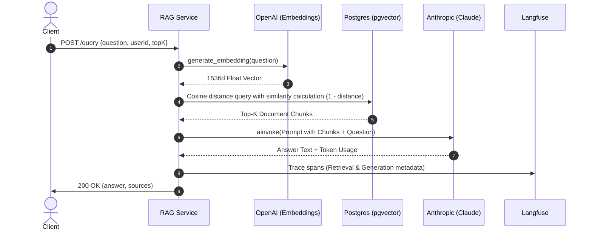

# GOA RAG Microservice Documentation

The RAG (Retrieval-Augmented Generation) microservice provides intelligent, context-aware query answering using a combination of vector database retrieval and Large Language Model reasoning.

---

## What is RAG? (Technical Deep Dive)

**Retrieval-Augmented Generation (RAG)** is an architectural pattern that enhances the capability of a Large Language Model (LLM) by dynamically injecting relevant, external, and up-to-date data directly into the model's prompt window. This approach bypasses the limitations of the model's static training set, limits "hallucinations," and enforces strict factual grounding.

The core mechanics of RAG rely on several key data science concepts:

### 1. Vector Embeddings
Unstructured text (documents, database rows) is passed through a deep learning embedding model to generate **vector embeddings**—high-dimensional arrays of floating-point numbers (e.g., 1536 dimensions for OpenAI). These vectors place text within a continuous semantic space. Words or sentences with similar meanings or themes are positioned close to each other in this space, regardless of the specific keywords used.

### 2. Distance and Similarity Metrics
To determine which documents match a user's question, we perform nearest-neighbor searches in the vector space. We use **Cosine Similarity** as our matching metric. 
- **Cosine Distance** ($\Leftrightarrow$ in `pgvector`) measures the angle between two vectors, ranging from $0.0$ (identical direction) to $2.0$ (opposite direction). It is defined mathematically as:
  \[\text{Cosine Distance}(A, B) = 1 - \frac{A \cdot B}{\|A\| \|B\|}\]
- **Cosine Similarity** represents semantic alignment and is calculated as:
  \[\text{Cosine Similarity}(A, B) = 1 - \text{Cosine Distance}(A, B)\]
Using similarity instead of Euclidean distance ($L_2$) ensures that document length variations do not distort retrieval accuracy.

### 3. Contextual Grounding (The Prompt Window)
Once the top $K$ matching documents are retrieved, they are combined with the user's original query into a structured system template. The instructions force the LLM to restrict its reasoning only to the provided text. If the answer cannot be deduced from the retrieved context, the LLM is instructed to respond with a fallback phrase (e.g., *"I don't know"*), effectively eliminating fabrication.

---

## How RAG is Structured in GOA

In the **GOA (Global Opportunity Access)** ecosystem, students ask specific questions about universities, admissions, program prerequisites (GPAs, ECTS), checklists, and country-specific visas. To answer these reliably, the RAG service utilizes a modular, high-performance architecture:

### 1. Storage & Ingestion Layer
Data is stored in `rag_db` (PostgreSQL 15) using the `pgvector` extension.
- **`documents` Table Schema**:
  - `id` (UUID, Primary Key): Unique identifier of the document chunk.
  - `content` (TEXT): The raw text snippet (e.g. parsed FAQ or visa guide).
  - `embedding` (VECTOR(1536)): Dense vector representation generated by OpenAI's `text-embedding-3-small`.
  - `source_url` (VARCHAR(255)): Origin URL for tracing facts back to their source.
  - `category` (VARCHAR(100)): Tag indicating data category (e.g., Admission, Visa).
  - `last_updated` (TIMESTAMP): Modification timestamp.

### 2. Retrieval Execution
The service embeds the user's question on-the-fly and runs a fast vector search directly in PostgreSQL:
```sql
SELECT id, content, source_url,
       1 - (embedding <=> $1::vector) AS similarity
FROM documents
ORDER BY embedding <=> $1::vector
LIMIT $2
```
This returns the most semantically relevant text chunks sorted by descending cosine similarity.

### 3. LLM Orchestration
The retrieved context is compiled into a prompt and sent to Anthropic's **`claude-haiku-4-5-20251001`** model. We leverage LangChain's standard interface to manage the payload transmission.

### 4. Telemetry & Observability
- **Langfuse Tracing**:
  - **Parent Trace**: Logs the overall request with `user_id` and `question_hash` (generated as a SHA256 substring: `hashlib.sha256(question.encode('utf-8')).hexdigest()[:16]`).
  - **Retrieval Span**: Captures the exact source database chunks returned, similarity scores, and DB fetch times.
  - **Generation Span**: Details LLM parameters, input/output token usage, model identifiers, API cost estimates ($0.25/M input, $1.25/M output), and latency.
- **Prometheus Metrics**:
  - `goa_rag_query_latency_ms`: Exposes query time distributions (labeled with `cache_hit="false"`).
  - `goa_rag_retrieval_similarity_score`: Measures vector match quality.
  - `goa_rag_low_confidence_total`: Automatically increments if the best vector match has a cosine similarity score below `0.6`, indicating the query lacked adequate reference context in our database.

---


## Architecture Flow

The following sequence diagram outlines the end-to-end execution of a `POST /query` request:



---

## API Endpoints

### 1. `POST /query`
Main endpoint used by internal microservices to query the RAG knowledge base.

- **Request Body (`QueryRequest`)**:
  ```json
  {
    "question": "What documents do I need for a German Student Visa?",
    "userId": "user-uuid-1234",
    "topK": 5
  }
  ```
- **Response Body (`QueryResponse`)**:
  ```json
  {
    "answer": "Based on the retrieved visa requirements, you need a valid passport, proof of sufficient financial funds (e.g. blocked account), and biometric photos...",
    "sources": [
      {
        "id": "d3b07384-d113-4956-a574-0f2c0032e52e",
        "content": "German student visa requirements: Valid passport, proof of funds of 11,208 EUR per year...",
        "source_url": "https://germany.info/visa",
        "similarity": 0.892
      }
    ]
  }
  ```

### 2. `POST /internal/visa-requirements`
Internal stub endpoint allowing data crawlers/ingestion pipelines to push parsed visa rules.
- **Request Body (`VisaRequirementsRequest`)**:
  ```json
  {
    "country": "Germany",
    "visa_type": "Student",
    "issuing_body": "German Embassy",
    "requirements": {
      "biometric_photo": true,
      "blocked_account_eur": 11208
    },
    "proof_of_funds": {
      "blocked_account": true
    },
    "source_url": "https://germany.info",
    "processing_days_min": 30,
    "processing_days_max": 90,
    "notes": "Must bring physical original documents.",
    "content_hash": "abc123hash"
  }
  ```
- **Response**:
  ```json
  {
    "status": "success",
    "message": "Stub processed successfully"
  }
  ```

### 3. `GET /health`
Liveness/Readiness probe endpoint.
- **Response**:
  ```json
  {
    "status": "healthy"
  }
  ```

### 4. `GET /metrics`
Prometheus metrics exporter endpoint. Exposes standard Python process metrics alongside:
- `goa_rag_query_latency_ms`: Histogram of query latencies.
- `goa_rag_retrieval_similarity_score`: Histogram of top similarity scores.
- `goa_rag_low_confidence_total`: Counter incremented whenever top similarity score falls below `0.6`.

---

## Database Schemas & Migrations

The service includes an automated **Migration Runner** executed on startup, tracking files in `migrations_log`. Below are the tables created by the migrations:

| Migration File | Tables / Extensions Created | Purpose |
| :--- | :--- | :--- |
| `001_enable_pgvector.sql` | `vector`, `uuid-ossp` | Installs the pgvector extension and UUID generators. |
| `002_create_documents.sql` | `documents` | Stores chunked raw text and their corresponding 1536-dimensional embeddings. |
| `003_create_program_requirements.sql` | `program_requirements` | Standard academic admissions requirement tables. |
| `004_create_local_user_profiles.sql` | `local_user_profiles` | Caches user profile snapshots (GPA, ECTS, target countries). |
| `005_create_faq_entries.sql` | `faq_entries` | FAQ list matching on standard trigram pattern indexing (`pg_trgm`). |
| `006_add_checklists.sql` | `checklists`, `checklist_item_states` | Stores student task checklists and progress status tags. |
| `007_add_visa_requirements.sql` | `visa_requirements` | Caches scraped visa details with a unique key on `(country, visa_type, issuing_body)`. |
