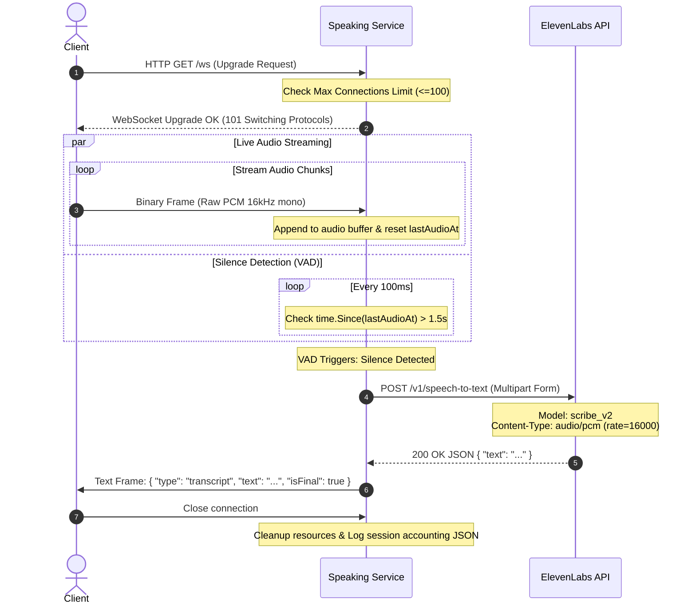

# Speaking Service Documentation

The **Speaking Service** is a real-time Go-based voice streaming and transcription pipeline designed for speaking evaluation. It establishes a WebSocket connection with clients, ingests live raw PCM audio streams, performs Voice Activity Detection (VAD) to identify silence gaps, transcribes speech via the ElevenLabs Speech-to-Text (STT) API, and reports transcriptions back to the client.

---

## Architecture & Data Flow

The service follows a concurrent, event-driven pattern leveraging Go channels and goroutines. Each client connection is handled by three dedicated goroutines:
1. **`readPump`**: Continuously reads binary messages (audio chunks) from the WebSocket and appends them to a memory-efficient audio buffer.
2. **`writePump`**: Listens on a channel for outbound text messages (e.g., transcripts) and writes them back to the client.
3. **`vadTicker`**: Scans the audio buffer state at regular intervals (100ms) to check for a silent period indicating the user finished speaking.

### System Workflow



---

## API Specifications

### WebSocket Connection

- **Endpoint**: `/ws`
- **Method**: `GET`
- **Query Parameters**:
  - `user_id` (optional): The ID of the authenticated user (defaults to `anonymous`).

#### Client Input Protocol
The client must send raw **PCM 16kHz mono audio** chunks as binary messages over the WebSocket. 

#### Server Output Protocol
When transcription completes, the server writes a text message to the WebSocket in JSON format:

```json
{
  "type": "transcript",
  "text": "The transcribed speech content.",
  "isFinal": true
}
```

---

## Technical Details

### Voice Activity Detection (VAD)
VAD is implemented using a time-based silence gap check rather than raw signal power calculations (since filtering happens upstream or on client devices).
- **Ticker Period**: 100ms
- **Silence Threshold**: 1.5 seconds (`1500*time.Millisecond`)
- When the silence threshold is reached and the audio buffer is not empty, the server copies the audio buffer, resets the primary buffer, and spawns a background goroutine to call the Speech-to-Text API.

### ElevenLabs STT Integration
- **Model**: `scribe_v2`
- **Audio MIME-Type**: `audio/pcm;rate=16000` (required for ElevenLabs Scribe API to accurately parse headerless PCM data).
- **Retry Policy**: 2 attempts maximum with a `500ms` backoff. A new request context and multipart writer body are rebuilt for retries to avoid reading empty/drained request bodies.
- **Connection Pooling**: Uses a custom pooled `http.Client` with tuned transport properties (`MaxIdleConns: 100`, `MaxIdleConnsPerHost: 100`, `IdleConnTimeout: 90s`) to prevent connection churn under high loads.

---

## Configuration & Environment Variables

The service loads configuration from environment variables:

| Variable | Description | Default |
| :--- | :--- | :--- |
| `PORT` | The port the HTTP server binds to. | `8082` |
| `MAX_CONNECTIONS` | The maximum allowed concurrent WebSocket connections. | `100` |
| `ELEVENLABS_API_KEY` | ElevenLabs API Key (Mock mode if empty). | `""` |
| `OTEL_SERVICE_NAME` | Service name for OpenTelemetry tracking. | `speaking` |
| `LANGFUSE_PUBLIC_KEY` | Langfuse tracking public key. | `""` |
| `LANGFUSE_SECRET_KEY` | Langfuse tracking secret key. | `""` |
| `LANGFUSE_HOST` | Langfuse endpoint host. | `https://cloud.langfuse.com` |

---

## Observability & Metrics

### Prometheus Metrics
Exposed at the `/metrics` endpoint:

- **`goa_speaking_active_connections`** (Gauge): Number of active WebSocket sessions currently handled by this instance.
- **`goa_speaking_transcription_ms`** (Histogram): ElevenLabs API call latency in milliseconds.
- **`goa_speaking_e2e_latency_ms`** (Histogram): End-to-end latency measured from the first audio chunk of a phrase to the transcript returned to the client.
- **`goa_speaking_goroutine_count`** (Gauge): Number of running goroutines, updated every 5 seconds using `runtime.NumGoroutine()`. Useful for detecting leaks.
- **`goa_speaking_sessions_total`** (Counter): Total sessions processed, labeled by `outcome` (`completed`, `dropped`, or `error`).

### Structured Logs
The service outputs JSON logs. On connection termination, a structured log summarizes the session's key statistics:

```json
{
  "level": "info",
  "session_id": "a4d320d3-3b10-449e-8a29-87a31bde9038",
  "user_id": "anonymous",
  "duration_s": 15.42,
  "transcription_ms": 780,
  "goroutines_at_close": 5,
  "outcome": "completed",
  "time": 1782138530,
  "message": "WebSocket connection closed"
}
```

---

## Development & Testing

### Running the Service Locally
Make sure you have Go installed, then execute:

```bash
go run .
```

### Running Tests
To run unit, integration, and load tests:

```bash
go test -v .
```

#### Test Suite Overview:
- **`TestAudioBufferAccumulation`**: Validates buffer writes and boundary checks.
- **`TestVADSilenceDetection`**: Verifies that the silence gap ticker triggers transcription after exactly 1500ms of silence, not before.
- **`TestIntegrationE2EAudioStreaming`**: Verifies websocket lifecycle, mock transcription, and client message dispatching.
- **`TestIntegrationMetricsAndSessionAccounting`**: Ensures active connection gauges increment and decrement correctly, and session outcomes are registered.
- **`TestConcurrentConnectionsLoad`**: Simulates 50 concurrent client connections performing streaming, audio uploads, and disconnects to verify performance stability and ensure zero goroutine leaks (using `runtime.NumGoroutine()`).
